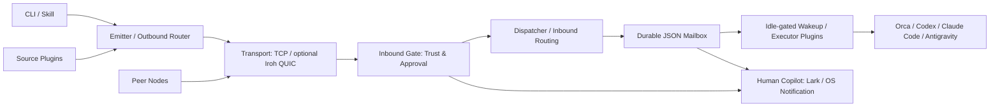

# The Dealer

[](LICENSE)
[](package.json)
[](package.json)
[](native/dealer-iroh-engine/Cargo.toml)
[](https://skills.sh/sensebeing/the-dealer)
[](https://github.com/sensebeing/the-dealer/stargazers)

**Connect isolated coding agents into a real-time local and P2P collaboration mesh.**

Developers often run Codex, Claude Code, Antigravity, and Orca on the same machine while their sessions stay isolated. The Dealer gives those agents a shared delivery protocol on one machine, and extends the same workflow to encrypted collaboration across machines and teams. Ed25519 node identities, receiver-owned trust gates, durable JSON mailbox waves, and real-time session wakeups keep handoffs verifiable, while `lark-mirror` and the OS `notify` executor keep human operators in the loop.

| Without the-dealer | With the-dealer |
| --- | --- |
| Copy tasks between isolated Codex, Claude Code, Antigravity, and Orca terminals, or hand them off through ad-hoc chat messages. | Unified same-machine task dispatch that extends to encrypted P2P delivery across machines and teams. |
| Check manually whether each receiver will accept a task. | Receiver-owned trust gates control admission and approval. |
| Track pending work in chat history and reconcile it after restarts. | Durable JSON mailbox leases preserve unacknowledged batches for recovery. |
| Keep checking whether a session is idle or has new messages. | Idle-gated real-time session wakeups include inline message previews. |

[中文文档](README.zh-CN.md) · [Get started](#get-started-in-30-seconds-paste-to-your-agent) · [Scenarios](#three-progressive-scenarios) · [Architecture](#architecture-and-real-time-session-delivery) · [Host presets](#host-profiles-agent-apps-and-presets) · [CLI reference](#cli-reference-and-bundled-skills)

## Get started in 30 seconds: paste to your agent

Paste either prompt into Claude Code, Codex, Cursor, Antigravity, or Orca.

### Prompt 1: Start or join on your machine

```text
Install and set up https://github.com/sensebeing/the-dealer on this machine.
Check existing installs and Node.js >=22.15 first. If the CLI is missing, run
`npm install -g git+https://github.com/sensebeing/the-dealer`; if I already have
a trusted ~/the-dealer checkout, use `npm --prefix ~/the-dealer link`.
Install the skills with `npx skills add sensebeing/the-dealer --global --agent '*'`,
preserving existing configuration. Follow the installed the-dealer-setup skill
to choose a host profile (orca-dev, codex-dev, claude-dev, or antigravity-dev)
and conversation mode (spawn, wave, fixed, or inbox-only), start dealerd, and verify
a local loopback message.
```

### Prompt 2: Invite a teammate or your second machine

```text
Use skills/the-dealer-setup/SKILL.md to generate a Dealer network invitation
(`dealer setup invite-prompt`) for my second machine or a teammate, and give me
a ready-to-forward onboarding message with the `dealer-net://v1/...` invite URI
and verification steps.
```

### Quick install

Install the CLI without a manual clone:

```sh
npm install -g git+https://github.com/sensebeing/the-dealer
```

From an existing checkout, use `npm --prefix ~/the-dealer link`. Install the skills for all supported agents:

```sh
npx skills add sensebeing/the-dealer --global --agent '*'
```

In Claude Code, you can also install the skills through its plugin marketplace:

```text
/plugin marketplace add sensebeing/the-dealer
/plugin install the-dealer@the-dealer
```

## Three progressive scenarios

Start with the agents already running on your laptop, then add machines or teammates using the same routing and mailbox primitives.

| Scenario | Setup | What it enables |
| --- | --- | --- |
| Same-machine multi-agent dispatch | `local` network (zero network setup) | Task handoffs and code review between Orca, Codex, Claude Code, and Antigravity through a local gate and mailbox pipeline. |
| Personal multi-machine mesh | `dealer network mount` and `dealer network invite` | Encrypted P2P messaging between a MacBook and a Studio or Linux workstation, each with its own Ed25519 key (`member@node`). |
| Team collaboration and source dispatch | Shared network with `approval_required` admission | Route tasks by member or advertised skill, connect source plugins, and redrive durable waves across restarts. |

### Cross-machine connectivity modes

Peers on one network segment discover each other over encrypted UDP beacons on
multicast group `239.255.42.99:45873` (plus subnet broadcast). When machines are
not on one LAN, pick one of these modes:

| Mode | How peers connect | Setup |
| --- | --- | --- |
| Same LAN (UDP 45873) | UDP multicast and subnet broadcast carry sealed discovery beacons; TCP carries frames. | Nothing to configure; keep `multicast` on. |
| Tailscale (UDP 45873) | Each node unicasts discovery to every online `tailscale status` peer on UDP 45873 and dials the routed `100.64.0.0/10` address over TCP. | Run Tailscale on every machine; no seed is required. |
| Self-hosted headless relay | One always-on node runs `dealer node up --profile headless-relay`. Isolated peers exchange sealed beacons through it, learn which seed can reach each peer, and relay frames and attachments through that seed when direct TCP is impossible. | Give every member the relay endpoint: `dealer project init --bootstrap-peers host:port` writes `onboarding.bootstrapPeers`, or pass `--seed host:port` to `dealer network mount`. |

Relay nodes are blind forwarders: discovery beacons and frames remain sealed with
the network key, and a seed only verifies that a frame belongs to a network it has
mounted before delivering it. Each node keeps one persistent tunnel per seed so the
seed can push relayed requests back through NAT. Use
`dealer node up --advertised-host <host>` (or `DEALER_ADVERTISED_HOST`) when a
machine must advertise a specific routable address instead of its detected LAN IP.

## Architecture and real-time session delivery



The microkernel manages plugin lifecycle and typed events. Outbound routing selects authenticated peer candidates, the inbound gate enforces admission policy, the dispatcher runs executors and signs receipts, and the mailbox persists delivery state using file locks and atomic `fsync` + rename writes.

| Capability | Behavior and boundary |
| --- | --- |
| Inline message preview | Wakeup pointers include a single-line preview of the latest message body, sender, and thread ID so agents can act on short messages immediately while mailbox leases remain the source of truth. |
| Instant conversational wakeups | Newly queued `question`, `reply`, and `settle` frames bypass wave coalescing (`0ms` delay) on their first delivery attempt while still respecting active leases, busy checks, and retry backoff. |
| Turn Autopilot compatibility | Idle checks recognize Turn Autopilot composer prefills as idle and send `Ctrl+U` (`\x15`) to clear a prefilled target-root composer before injecting the wakeup pointer. Human drafts remain busy. |
| Unified session modes | Orca, Codex, Claude Code, and Antigravity (`agy`) all support `spawn`, `wave`, `fixed`, and `inbox-only` modes, backed by durable wakeup redrive. |
| Human copilot mirrors | `lark-mirror` mirrors inbound approvals and mailbox events to Lark cards or threads, and the `notify` executor posts native OS notifications. |

See [architecture](docs/architecture.md), [wire protocol](docs/wire-protocol.md), and the [agent app matrix](skills/the-dealer-setup/references/agent-app-matrix.md).

## Host profiles, agent apps, and presets

### Host profiles and sample patches

| Host (`--host`) | Startup profile (`--profile`) | Sample patch | Named executor |
| --- | --- | --- | --- |
| `orca` | `orca-dev` | [orca.patch.json](examples/user-patches/orca.patch.json) | `orca` (`orca-spawn` / `orca-wave`) |
| `codex` | `codex-dev` | [codex.patch.json](examples/user-patches/codex.patch.json) | `codex-cli` / `codex` |
| `claude-code` | `claude-dev` | [claude-code.patch.json](examples/user-patches/claude-code.patch.json) | `claude-code` |
| `antigravity` | `antigravity-dev` | [antigravity.patch.json](examples/user-patches/antigravity.patch.json) | `antigravity-cli` / `antigravity-app` / `antigravity` |

All four startup profiles use the `open` gate and enable `dedup-cas`; use
`--gate approval_required` or `dealer gate mode approval_required` when approval
is required.

### Supported agent apps and conversation modes

| Host / mode | `spawn` | `wave` | `fixed` | `inbox-only` |
| --- | --- | --- | --- | --- |
| `orca` | Child worktree | Workspace wave | Fixed session | Durable mailbox |
| Desktop Apps: `claude-app` / `chatgpt-app` / `antigravity-app` | New session | Wave queue | Fixed session | Durable mailbox |
| Terminal CLIs: `claude-code` / `codex-cli` / `antigravity-cli` | New session | Wave queue | Fixed session | Durable mailbox |
| `inbox` | — | — | — | Manual inbox |

Bridge presets for `chatgpt-dot` and `grok-bot` (`--target-bot`) are also available.

### Request and binding presets

Pass a `--host` and `--mode` pair to `dealer setup binding-preset` or `dealer setup apply-preset` (default topic: `collab.request.v4`):

| Preset | Arguments | Generated executor |
| --- | --- | --- |
| `orca-fixed` | `--host orca --mode fixed` | `orca` (`mode: fixed`) |
| `orca-spawn` | `--host orca --mode spawn` | `orca` (`mode: spawn`) |
| `codex-spawn` | `--host codex --mode spawn` | `codex-cli` / `codex` (`mode: spawn`) |
| `codex-fixed` | `--host codex --mode fixed` | `codex-cli` / `codex` (`mode: fixed`) |
| `claude-spawn` | `--host claude-code --mode spawn` | `claude-code` (`mode: spawn`) |
| `claude-fixed` | `--host claude-code --mode fixed` | `claude-code` (`mode: fixed`) |
| `antigravity-spawn` | `--host antigravity --mode spawn` | `antigravity-cli` (`mode: spawn`) |
| `antigravity-fixed` | `--host antigravity --mode fixed` | `antigravity-app` (`mode: fixed`) |
| `lark-mirror` | `apply-preset --notify-lark` | Marks the binding for Lark mirroring (configure `larkNotify` credentials in `~/.dealer/config.json`) |

```sh
dealer node up --profile codex-dev --json
dealer setup binding-preset --host codex --mode fixed --topic collab.request.v4 --session-id <thread> --json
dealer setup apply-preset --host codex --mode fixed --topic collab.request.v4 --session-id <thread> --set-default --json
dealer setup apply-preset --host orca --mode spawn --project <project-id> --workspace-path <receiver-repo> --agent codex --json
```

`binding-preset` prints a proposed patch without modifying disk state. `apply-preset` writes the binding to `~/.dealer/config.json`, enables required executors, and hot-reloads a running daemon. Link project-specific patches with `dealer project link <repo> --user-patch <file> --json`.

## Extend in three tiers

| Tier | Configuration | Ownership boundary |
| --- | --- | --- |
| 1. Personal overrides | `~/.dealer/config.json` | Node profile, inbound gate mode, executor settings, and notification targets. |
| 2. Project patches | `~/.dealer/projects/<project>.patch.json` linked to `.dealer/project.json` | Shared topics and plugin references live in the repo; local paths and session IDs stay on the receiver. |
| 3. Custom plugins | Source, Router, Executor, and Notifier plugins | Typed contracts in [packages/core-types/index.ts](packages/core-types/index.ts) loaded via `~/.dealer/plugins/` or `.dealer/plugins/`. |

See [the-dealer-extend](skills/the-dealer-extend/SKILL.md) and the [plugin guide](docs/plugin-guide.md). Manage personal plugins with `dealer plugin add`, `dealer plugin list`, and `dealer plugin remove`.

## CLI reference and bundled skills

| Command | Purpose |
| --- | --- |
| `dealer setup probe --json` | Detect installed agent CLIs and inspect redacted node configuration. |
| `dealer node up --profile orca-dev --json` / `dealer node status --json` | Start `dealerd` or inspect daemon status. |
| `dealer node up --advertised-host <host> --json` | Advertise a specific routable host (or set `DEALER_ADVERTISED_HOST`). |
| `dealer network mount <id> --passphrase '<secret>' --gate approval_required --json` | Mount a network with a shared secret. |
| `dealer project init --root <repo> --bootstrap-peers <host:port,host:port> --json` | Scaffold a project that publishes self-hosted relay seeds in `onboarding.bootstrapPeers`. |
| `dealer network invite <id> --ttl 1h --json` | Generate a `dealer-net://v1/...` network invitation URI. |
| `dealer network mount '<invite>' --json` / `dealer network unmount <id> --json` | Join or detach from a mounted network. |
| `dealer peers list --network <id> --json` | List discovered peers in a network. |
| `dealer send --network local --to member:alice --topic collab.request.v4 --body 'Review this change' --json` | Send a routed task or message. |
| `dealer inbox check --mailbox <id> --json` | Claim pending messages as a delivery lease. |
| `dealer inbox ack <dlv-id> --mailbox <id> --json` | Acknowledge and settle a delivery lease. |
| `dealer thread show <message-id> --json` | Inspect thread history and reverse-routing state. |
| `dealer ask` / `dealer reply` / `dealer settle` | Continue or settle a bi-directional agent thread. |

| Bundled skill | Purpose |
| --- | --- |
| [the-dealer-setup](skills/the-dealer-setup/SKILL.md) | Interactive onboarding, host selection, network mounting, and loopback verification. |
| [the-dealer](skills/the-dealer/SKILL.md) | Daily task dispatch, inbox leases, thread replies, and approval management. |
| [the-dealer-extend](skills/the-dealer-extend/SKILL.md) | Personal overrides, project source plugins, and custom executors. |

## Security and verification

Ed25519 keys sign node cards, envelopes, and delivery receipts. Per-network keys derived with HKDF-SHA256 and AES-256-GCM authenticate and encrypt frames, and streaming BLAKE3 hashes verify content-addressed file attachments. Receivers enforce `open`, `approval_required`, `dnd`, or `closed` gates and resolve project IDs to local roots on the receiving machine.

Requires Node.js >=22.15 (TypeScript runs directly via Node's built-in type stripping). Building the optional Rust Iroh engine requires Rust/Cargo:

```sh
npm test
guard check --base origin/main
guard review
git diff --check
# Optional Rust Iroh native engine
npm run build:native
```

See [Contributing](CONTRIBUTING.md), [Security](SECURITY.md), [Changelog](CHANGELOG.md), and the [MIT License](LICENSE).


## Related projects

| Project | What it does |
| --- | --- |
| [the-guard](https://github.com/sensebeing/the-guard) | Architecture topology checks and independent agent review before merging. |
| [the-pilot](https://github.com/sensebeing/the-pilot) | Scene-based Turn Autopilot and multi-agent orchestration for coding agents in Orca. |

If the-dealer helps your team coordinate coding agents, a star on GitHub helps other teams find it.
