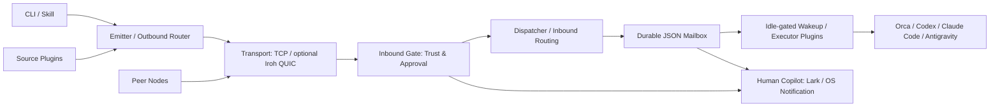

# The Dealer

[](LICENSE)
[](package.json)
[](package.json)
[](native/dealer-iroh-engine/Cargo.toml)

**Turn isolated coding agents into a real-time, zero-config local and P2P collaboration mesh.**

One developer can run Codex, Claude Code, Antigravity and Orca on a single Mac—yet their conversations remain isolated. The Dealer connects them through a shared delivery protocol, then extends the same workflow to encrypted collaboration across machines and teams. Ed25519 identities, receiver-owned trust gates, durable JSON mailbox waves and real-time session wakeups keep handoffs accountable. The default TCP transport has an optional Rust Iroh QUIC engine; `lark-mirror` and the OS `notify` executor keep the human copilot in the loop.

[中文文档](README.zh-CN.md) · [Get started](#get-started-in-30-seconds--copy--paste-to-your-agent) · [Scenarios](#why-the-dealer--three-progressive-scenarios) · [Architecture](#architecture--real-time-session-delivery) · [Host presets](#host-profiles-agent-apps--one-command-presets) · [CLI](#cli-cheat-sheet--bundled-skills)

## Get Started in 30 Seconds — Copy & Paste to Your Agent

Paste either prompt into your coding agent. The agent inspects your machine and performs setup; the prompts do not assume that every host CLI is installed.

### Prompt 1 — Start or Join on Your Machine

```text
Set up The Dealer, preserving my existing configuration and identity.

1. Check `node --version` (Node >=22.6) and `command -v dealer`.
   Clone https://github.com/sensebeing/the-dealer.git to ~/the-dealer if absent.
   For an existing checkout, inspect local changes and its remote before running
   `git -C ~/the-dealer pull --ff-only`. Install with `npm --prefix ~/the-dealer link`.
   Preserve an existing installation if it points to another trusted checkout.
2. Create ~/.agents/skills/, ~/.claude/skills/ and ~/.gemini/config/skills/.
   Symlink each directory below into all three skill directories:
   ~/the-dealer/skills/the-dealer
   ~/the-dealer/skills/the-dealer-setup
   ~/the-dealer/skills/the-dealer-extend
   Preserve unrelated files; resolve conflicting links before replacement.
   Read ~/the-dealer/skills/the-dealer-setup/SKILL.md.
3. Run `dealer setup probe --json` and `dealer node status --json`.
   Ask for my member handle, node name, host and mode (spawn/fixed/inbox-only).
   Use local collaboration unless I request a remote network. Never replace
   ~/.dealer/identity.json or copy another machine's private key.
4. Select the host profile: orca-dev, codex-dev, claude-dev or antigravity-dev.
   Start dealerd with `dealer node up --profile <profile> --member <member>
   --name <node> --json`. If a daemon already runs, preserve its configuration;
   coordinate any required restart rather than starting a second daemon.
   Generate `dealer setup binding-preset --host <host> --mode <mode> --json`,
   then apply the reviewed selectors with `dealer setup apply-preset` using
   the same arguments. Add receiver-owned project/workspace or session IDs
   where required; inspect host CLI help to verify the generated argv contract.
5. For a safe self-loopback, apply an inbox-only binding to setup.ping:
   `dealer setup apply-preset --host <host> --mode inbox-only --topic setup.ping --json`.
   Send `dealer send --network local --to member:<member> --topic setup.ping
   --body 'Dealer loopback check' --json`. Resolve any pending approval explicitly.
   Read `dealer inbox check --mailbox stream:setup.ping --json`, verify the body,
   and acknowledge the returned delivery lease. Verify a reply using the daily
   skill. Report mailbox readback separately from actual host execution.
6. If I provide a remote invite, mount it with `dealer network mount '<invite>'
   --json`, keep approval_required, then verify peer discovery and replies.
```

### Prompt 2 — Invite a Teammate or Your Second Machine

```text
Prepare a private Dealer invitation and a ready-to-forward onboarding message.

1. Read the-dealer-setup/SKILL.md and inspect `dealer node status --json`.
   Ask which network to share and whether this is my own machine or a teammate.
   Reuse an existing network. For a new network generate a strong secret and run
   `dealer network mount <network-id> --passphrase '<secret>'
   --gate approval_required --json`. Keep secrets out of logs and source control.
2. Run `dealer setup invite-prompt --network <network-id> --member <my-handle>
   --peer-member <recipient-handle> --name <recipient-node> --ttl 1h --json`.
   Use the returned dealer-net://v1/... invite without editing it. If the detected
   TCP address is not reachable, specify `--seed <reachable-host:port>`.
3. Return crossMachinePrompt for my own machine or teammatePrompt for a teammate
   as a complete message I can forward privately; do not send it automatically.
   Ensure it covers Node >=22.6, installation, all three bundled skill symlinks,
   a distinct node identity, selected host/mode and the exact network mount command.
   Replace placeholders with confirmed identities; do not copy private keys.
4. The recipient should inspect the host CLI contract, apply the receiving
   binding, keep approval_required, run `dealer peers list --network <network-id>
   --json`, and verify a ping and reply in both directions plus mailbox readback.
   If generation occurred offline for an unmounted network, mount that same
   invite on the creator too. Distinguish delivery receipts from task completion.
```

Invites carry the network shared secret. Their expiry limits importing, not continued access. Default TCP seeds require a reachable address and port; they do not bypass NAT or firewalls. See the [setup guide](skills/the-dealer-setup/SKILL.md).

## Why The Dealer & Three Progressive Scenarios

Start with the agents you already run; add machines and teammates without inventing another handoff protocol.

| Scenario | Setup | What it enables |
| --- | --- | --- |
| **Same-Machine Multi-Agent Dispatch** | `local`; zero network setup | Handoffs and review between Orca, Codex, Claude Code and Antigravity through the same gate and mailbox pipeline. |
| **Personal Multi-Machine Mesh** | `dealer network mount` and `dealer network invite` | Connect a MacBook and Studio/Linux workstation; each retains its own key. Address a specific machine with `member@node`. |
| **Team Collaboration & Source Dispatch** | Shared network, verified sender identities, receiver-owned `approval_required` admission | Route by member or advertised skill; connect source plugins, durable waves and restart-safe redrive. Explicit trust or `open` admission is a receiver decision. |

## Architecture & Real-Time Session Delivery



The kernel owns lifecycle and typed events. Outbound routing selects authenticated candidates; the gate owns admission, the dispatcher owns execution and receipts, and the mailbox owns durable records. JSON state uses file locks and atomic `fsync`/rename writes. No second delivery ledger is introduced by the host adapters.

| Capability | Behavior and boundary |
| --- | --- |
| Inline message preview | Wakeup pointers include bounded latest-message text, sender and thread. Short messages are visible immediately; mailbox leases remain authoritative. |
| Instant conversational wakeups | `question` / `reply` / `settle` frames use `0ms` coalescing. Active claims, busy workspaces and retry backoff still apply; this is not a latency guarantee. |
| Turn Autopilot compatibility | Recognized recommendation prefills are treated as idle. `Ctrl+U` clears a target-root prefill before its pointer; a child prefill does not request clearing the root composer. Human drafts remain busy. |
| Unified session modes | Orca, Codex, Claude Code and Antigravity (`agy`) expose `spawn`, `fixed` and `inbox-only` configuration. Orca-managed wakeups have durable idle-gated redrive; other host behavior depends on installed CLI contracts. |
| Human copilot mirrors | `lark-mirror` mirrors eligible mailbox/approval events; the `notify` executor provides OS notifications. Notification does not grant approval or prove agent completion. |

See [architecture](docs/architecture.md), [wire protocol](docs/wire-protocol.md), and the [host matrix](skills/the-dealer-setup/references/agent-app-matrix.md).

## Host Profiles, Agent Apps & One-Command Presets

### Host profiles and sample patches

| Host (`--host`) | Startup profile (`--profile`) | Sample patch | Named executor |
| --- | --- | --- | --- |
| `orca` | `orca-dev` | [orca.patch.json](examples/user-patches/orca.patch.json) | `orca-spawn` / `orca-wave` |
| `codex` | `codex-dev` | [codex.patch.json](examples/user-patches/codex.patch.json) | `codex` |
| `claude-code` | `claude-dev` | [claude-code.patch.json](examples/user-patches/claude-code.patch.json) | `claude-code` |
| `antigravity` | `antigravity-dev` | [antigravity.patch.json](examples/user-patches/antigravity.patch.json) | `antigravity` |

All four profiles use `approval_required` and `dedup-cas`. Host names and startup profile names are different CLI arguments.

### Supported Agent Apps and conversation modes

| Host / mode | `spawn` | `fixed` | Receiver requirements |
| --- | --- | --- | --- |
| `orca` | New child worktree | Idle-gated workspace | Receiver project/workspace and inner `--agent` |
| `codex` | New CLI worktree session | Existing thread queue | Compatible CLI; optional profile and fixed session ID |
| `claude-code` | Background conversation | Resumed session | Compatible CLI; optional profile and fixed session ID |
| `antigravity` | Orca-managed agy worktree | Orca-managed agy workspace | Orca and agy; standalone named executor also available |
| `inbox-only` (mode on any host) | No launch | No launch | Durable manual intake, no external executor |

`chatgpt-dot` and `grok-bot` bridge presets also exist; Grok execution requires `--target-bot`. CLI presence does not prove support for generated queue/background flags. Verify the installed version's interface before enabling it.

### Canonical request and binding presets

The names below describe `--host` / `--mode` pairs, not additional preset IDs. The default topic is `collab.request.v4`.

| Configuration | Arguments | Generated executor |
| --- | --- | --- |
| `orca-fixed` | `--host orca --mode fixed` | `orca-wave` |
| `orca-spawn` | `--host orca --mode spawn` | `orca-spawn` |
| `codex-spawn` | `--host codex --mode spawn` | `agent-pty` |
| `codex-fixed` | `--host codex --mode fixed` | `agent-pty` |
| `claude-spawn` | `--host claude-code --mode spawn` | `agent-pty` |
| `claude-fixed` | `--host claude-code --mode fixed` | `agent-pty` |
| `antigravity-spawn` | `--host antigravity --mode spawn` | `orca-spawn` |
| `antigravity-fixed` | `--host antigravity --mode fixed` | `orca-wave` |
| `lark-mirror` (notification plugin) | `apply-preset --notify-lark` enables binding eligibility | Configure `larkNotify` credentials/target separately; not a binding-preset host |

```sh
dealer node up --profile codex-dev --json
dealer setup binding-preset --host codex --mode fixed --topic collab.request.v4 --session-id <thread> --json
dealer setup apply-preset --host codex --mode fixed --topic collab.request.v4 --session-id <thread> --set-default --json
dealer setup apply-preset --host orca --mode spawn --project <project-id> --workspace-path <receiver-repo> --agent codex --json
```

Replace angle-bracket placeholders before running. `binding-preset` only prints a proposal. `apply-preset` persists bindings, enables required executors and updates a live daemon without a restart. `--set-default` changes unbound-message delivery to the named host executor; omit it to preserve the default. Sample patches use named executors directly. Link project patches with `dealer project link <repo> --user-patch <file> --json`; project patches do not change node-wide startup profiles.

## Extend in 3 Tiers

| Tier | Configuration | Owner boundary |
| --- | --- | --- |
| **1. Personal overrides** | `~/.dealer/config.json`; generated host bindings | Node profile, receiver gates, executor settings and notification targets. |
| **2. Project patches** | `~/.dealer/projects/<project>.patch.json`, linked to `.dealer/project.json` | Shared topics and plugin references live in the project; local paths and sessions stay receiver-owned. |
| **3. Custom plugins** | Source / Router / Executor plugins and notifier lifecycle hooks | Contracts in [packages/core-types/index.ts](packages/core-types/index.ts); external factory API and kernel lifecycle preserve one semantic owner. |

Use [the-dealer-extend](skills/the-dealer-extend/SKILL.md) and the [plugin guide](docs/plugin-guide.md). Personal plugin modules live in `~/.dealer/plugins/`; `dealer plugin add`, `list` and `remove` manage them through the daemon. Keep npm runtime dependencies at zero.

## CLI Cheat Sheet & Bundled Skills

| Command | Purpose |
| --- | --- |
| `dealer setup probe --json` | Inspect installed hosts and redacted node configuration. |
| `dealer node up --profile orca-dev --json` / `dealer node status --json` | Start dealerd / inspect its state. |
| `dealer network mount <id> --passphrase '<secret>' --gate approval_required --json` | Create a local network mount. |
| `dealer network invite <id> --ttl 1h --json` | Generate a shared-secret invite. |
| `dealer network mount '<invite>' --json` / `dealer network unmount <id> --json` | Join / detach a network. |
| `dealer peers list --network <id> --json` | Inspect peers in one network. |
| `dealer send --network local --to member:alice --topic collab.request.v4 --body 'Review this change' --json` | Send a routed message. |
| `dealer inbox check --mailbox <id> --json` | Acquire pending mail as a delivery lease. |
| `dealer inbox ack <dlv-id> --mailbox <id> --json` | Acknowledge that lease. |
| `dealer thread show <message-id> --json` | Read conversation state and reverse routing. |
| `dealer ask` / `dealer reply` / `dealer settle` | Conversation protocol; see the daily skill for required arguments. |

| Bundled skill | Use it for |
| --- | --- |
| [the-dealer-setup](skills/the-dealer-setup/SKILL.md) | Installation, topology, host selection and verified onboarding. |
| [the-dealer](skills/the-dealer/SKILL.md) | Sending, replying, delivery leases and settlement. |
| [the-dealer-extend](skills/the-dealer-extend/SKILL.md) | Personal overrides, project sources and custom integrations. |

## Security & Verification

Ed25519 signs node cards, envelopes and receipts. HKDF-SHA256 derives network-specific keys; AES-256-GCM isolates frames. Invitations carry a shared secret and expiry rather than a signed capability token. BLAKE3 verifies streamed content-addressed attachments. The receiver controls `open`, `approval_required`, `dnd` and `closed` admission and maps project IDs to trusted local roots; incoming filesystem paths cannot select execution roots. Unknown external side effects are not safe automatic replays.

Use Node.js >=22.6; TypeScript runs directly with Node's type stripping. The optional native engine needs Rust/Cargo and builds separately; building it does not select it as the default transport.

```sh
npm test
git diff --check
# Optional Rust engine / 可选 Rust 引擎
npm run build:native
```

Tests cover crypto, lifecycle, routing, gates, mailbox recovery and real daemon round trips. Mocked host tests are not proof that a specific installed Agent App completed work. Report native build and live host verification separately.

[Contributing](CONTRIBUTING.md) · [Security policy](SECURITY.md) · [Changelog](CHANGELOG.md) · [MIT License](LICENSE)
