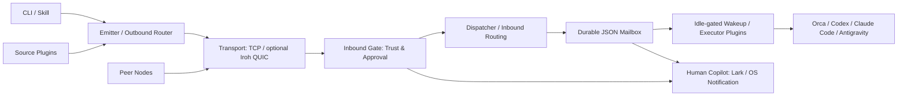

# The Dealer

[](LICENSE)
[](package.json)
[](package.json)
[](native/dealer-iroh-engine/Cargo.toml)

**Connect isolated coding agents into a real-time local and P2P collaboration mesh.**

Developers often run Codex, Claude Code, Antigravity, and Orca on the same machine while their sessions stay isolated. The Dealer gives those agents a shared delivery protocol on one machine, and extends the same workflow to encrypted collaboration across machines and teams. Ed25519 node identities, receiver-owned trust gates, durable JSON mailbox waves, and real-time session wakeups keep handoffs verifiable, while `lark-mirror` and the OS `notify` executor keep human operators in the loop.

[中文文档](README.zh-CN.md) · [Get started](#get-started-in-30-seconds-paste-to-your-agent) · [Scenarios](#three-progressive-scenarios) · [Architecture](#architecture-and-real-time-session-delivery) · [Host presets](#host-profiles-agent-apps-and-presets) · [CLI reference](#cli-reference-and-bundled-skills)

## Get started in 30 seconds: paste to your agent

Paste either prompt into Claude Code, Codex, Cursor, Antigravity, or Orca.

### Prompt 1: Start or join on your machine

```text
Install and set up https://github.com/sensebeing/the-dealer on this machine.
Clone or update ~/the-dealer, run `npm --prefix ~/the-dealer link`, and symlink
skills/the-dealer, skills/the-dealer-setup, and skills/the-dealer-extend into my
agent skill directories. Then follow skills/the-dealer-setup/SKILL.md to help me
choose a host profile (orca-dev, codex-dev, claude-dev, or antigravity-dev) and
conversation mode (spawn, fixed, or inbox-only), start dealerd, and verify a local
loopback message.
```

### Prompt 2: Invite a teammate or your second machine

```text
Use skills/the-dealer-setup/SKILL.md to generate a Dealer network invitation
(`dealer setup invite-prompt`) for my second machine or a teammate, and give me
a ready-to-forward onboarding message with the `dealer-net://v1/...` invite URI
and verification steps.
```

## Three progressive scenarios

Start with the agents already running on your laptop, then add machines or teammates using the same routing and mailbox primitives.

| Scenario | Setup | What it enables |
| --- | --- | --- |
| Same-machine multi-agent dispatch | `local` network (zero network setup) | Task handoffs and code review between Orca, Codex, Claude Code, and Antigravity through a local gate and mailbox pipeline. |
| Personal multi-machine mesh | `dealer network mount` and `dealer network invite` | Encrypted P2P messaging between a MacBook and a Studio or Linux workstation, each with its own Ed25519 key (`member@node`). |
| Team collaboration and source dispatch | Shared network with `approval_required` admission | Route tasks by member or advertised skill, connect source plugins, and redrive durable waves across restarts. |

## Architecture and real-time session delivery



The microkernel manages plugin lifecycle and typed events. Outbound routing selects authenticated peer candidates, the inbound gate enforces admission policy, the dispatcher runs executors and signs receipts, and the mailbox persists delivery state using file locks and atomic `fsync` + rename writes.

| Capability | Behavior and boundary |
| --- | --- |
| Inline message preview | Wakeup pointers include a single-line preview of the latest message body, sender, and thread ID so agents can act on short messages immediately while mailbox leases remain the source of truth. |
| Instant conversational wakeups | Newly queued `question`, `reply`, and `settle` frames bypass wave coalescing (`0ms` delay) on their first delivery attempt while still respecting active leases, busy checks, and retry backoff. |
| Turn Autopilot compatibility | Idle checks recognize Turn Autopilot composer prefills as idle and send `Ctrl+U` (`\x15`) to clear a prefilled target-root composer before injecting the wakeup pointer. Human drafts remain busy. |
| Unified session modes | Orca, Codex, Claude Code, and Antigravity (`agy`) all support `spawn`, `fixed`, and `inbox-only` modes, backed by durable wakeup redrive. |
| Human copilot mirrors | `lark-mirror` mirrors inbound approvals and mailbox events to Lark cards or threads, and the `notify` executor posts native OS notifications. |

See [architecture](docs/architecture.md), [wire protocol](docs/wire-protocol.md), and the [agent app matrix](skills/the-dealer-setup/references/agent-app-matrix.md).

## Host profiles, agent apps, and presets

### Host profiles and sample patches

| Host (`--host`) | Startup profile (`--profile`) | Sample patch | Named executor |
| --- | --- | --- | --- |
| `orca` | `orca-dev` | [orca.patch.json](examples/user-patches/orca.patch.json) | `orca-spawn` / `orca-wave` |
| `codex` | `codex-dev` | [codex.patch.json](examples/user-patches/codex.patch.json) | `codex` |
| `claude-code` | `claude-dev` | [claude-code.patch.json](examples/user-patches/claude-code.patch.json) | `claude-code` |
| `antigravity` | `antigravity-dev` | [antigravity.patch.json](examples/user-patches/antigravity.patch.json) | `antigravity` |

All four startup profiles enable `approval_required` and `dedup-cas`.

### Supported agent apps and conversation modes

| Host / mode | `spawn` | `fixed` | Receiver parameters |
| --- | --- | --- | --- |
| `orca` | New child worktree | Idle-gated workspace | Receiver project/workspace and inner `--agent` |
| `codex` | New CLI worktree session | Existing thread queue | Optional `--agent-profile` and fixed `--session-id` |
| `claude-code` | Background conversation | Resumed session | Optional `--agent-profile` and fixed `--session-id` |
| `antigravity` | Orca-managed `agy` worktree | Orca-managed `agy` workspace | Orca workspace or standalone `antigravity` executor |
| `inbox-only` (any host) | No process launch | No process launch | Durable mailbox intake for manual `dealer inbox check` |

Bridge presets for `chatgpt-dot` and `grok-bot` (`--target-bot`) are also available.

### Request and binding presets

Pass a `--host` and `--mode` pair to `dealer setup binding-preset` or `dealer setup apply-preset` (default topic: `collab.request.v4`):

| Preset | Arguments | Generated executor |
| --- | --- | --- |
| `orca-fixed` | `--host orca --mode fixed` | `orca-wave` |
| `orca-spawn` | `--host orca --mode spawn` | `orca-spawn` |
| `codex-spawn` | `--host codex --mode spawn` | `agent-pty` |
| `codex-fixed` | `--host codex --mode fixed` | `agent-pty` |
| `claude-spawn` | `--host claude-code --mode spawn` | `agent-pty` |
| `claude-fixed` | `--host claude-code --mode fixed` | `agent-pty` |
| `antigravity-spawn` | `--host antigravity --mode spawn` | `orca-spawn` |
| `antigravity-fixed` | `--host antigravity --mode fixed` | `orca-wave` |
| `lark-mirror` | `apply-preset --notify-lark` | Marks the binding for Lark mirroring (configure `larkNotify` credentials in `~/.dealer/config.json`) |

```sh
dealer node up --profile codex-dev --json
dealer setup binding-preset --host codex --mode fixed --topic collab.request.v4 --session-id <thread> --json
dealer setup apply-preset --host codex --mode fixed --topic collab.request.v4 --session-id <thread> --set-default --json
dealer setup apply-preset --host orca --mode spawn --project <project-id> --workspace-path <receiver-repo> --agent codex --json
```

`binding-preset` prints a proposed patch without modifying disk state. `apply-preset` writes the binding to `~/.dealer/config.json`, enables required executors, and hot-reloads a running daemon. Link project-specific patches with `dealer project link <repo> --user-patch <file> --json`.

## Extend in three tiers

| Tier | Configuration | Ownership boundary |
| --- | --- | --- |
| 1. Personal overrides | `~/.dealer/config.json` | Node profile, inbound gate mode, executor settings, and notification targets. |
| 2. Project patches | `~/.dealer/projects/<project>.patch.json` linked to `.dealer/project.json` | Shared topics and plugin references live in the repo; local paths and session IDs stay on the receiver. |
| 3. Custom plugins | Source, Router, Executor, and Notifier plugins | Typed contracts in [packages/core-types/index.ts](packages/core-types/index.ts) loaded via `~/.dealer/plugins/` or `.dealer/plugins/`. |

See [the-dealer-extend](skills/the-dealer-extend/SKILL.md) and the [plugin guide](docs/plugin-guide.md). Manage personal plugins with `dealer plugin add`, `dealer plugin list`, and `dealer plugin remove`.

## CLI reference and bundled skills

| Command | Purpose |
| --- | --- |
| `dealer setup probe --json` | Detect installed agent CLIs and inspect redacted node configuration. |
| `dealer node up --profile orca-dev --json` / `dealer node status --json` | Start `dealerd` or inspect daemon status. |
| `dealer network mount <id> --passphrase '<secret>' --gate approval_required --json` | Mount a network with a shared secret. |
| `dealer network invite <id> --ttl 1h --json` | Generate a `dealer-net://v1/...` network invitation URI. |
| `dealer network mount '<invite>' --json` / `dealer network unmount <id> --json` | Join or detach from a mounted network. |
| `dealer peers list --network <id> --json` | List discovered peers in a network. |
| `dealer send --network local --to member:alice --topic collab.request.v4 --body 'Review this change' --json` | Send a routed task or message. |
| `dealer inbox check --mailbox <id> --json` | Claim pending messages as a delivery lease. |
| `dealer inbox ack <dlv-id> --mailbox <id> --json` | Acknowledge and settle a delivery lease. |
| `dealer thread show <message-id> --json` | Inspect thread history and reverse-routing state. |
| `dealer ask` / `dealer reply` / `dealer settle` | Continue or settle a bi-directional agent thread. |

| Bundled skill | Purpose |
| --- | --- |
| [the-dealer-setup](skills/the-dealer-setup/SKILL.md) | Interactive onboarding, host selection, network mounting, and loopback verification. |
| [the-dealer](skills/the-dealer/SKILL.md) | Daily task dispatch, inbox leases, thread replies, and approval management. |
| [the-dealer-extend](skills/the-dealer-extend/SKILL.md) | Personal overrides, project source plugins, and custom executors. |

## Security and verification

Ed25519 keys sign node cards, envelopes, and delivery receipts. Per-network keys derived with HKDF-SHA256 and AES-256-GCM authenticate and encrypt frames, and streaming BLAKE3 hashes verify content-addressed file attachments. Receivers enforce `open`, `approval_required`, `dnd`, or `closed` gates and resolve project IDs to local roots on the receiving machine.

Requires Node.js >=22.6 (TypeScript runs directly via Node's built-in type stripping). Building the optional Rust Iroh engine requires Rust/Cargo:

```sh
npm test
git diff --check
# Optional Rust Iroh native engine
npm run build:native
```

See [Contributing](CONTRIBUTING.md), [Security](SECURITY.md), [Changelog](CHANGELOG.md), and the [MIT License](LICENSE).
