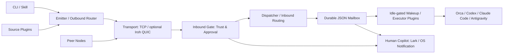

# The Dealer

[](LICENSE)
[](package.json)
[](package.json)
[](native/dealer-iroh-engine/Cargo.toml)

**让独立运行的 Coding Agent 连成实时、零配置的单机与跨机加密 P2P 协作网络。**

一个开发者可以在同一台 Mac 上同时运行 Codex、Claude Code、Antigravity 和 Orca，但这些会话仍然彼此隔离。The Dealer 用统一的投递协议连接它们，再将相同工作流扩展到跨机器、跨团队的加密协作。Ed25519 身份、接收端信任门禁、持久化 JSON 信箱波次和实时会话唤醒，让任务交接有据可查。默认 TCP 传输可搭配可选的 Rust Iroh QUIC 引擎；`lark-mirror` 与系统 `notify` 执行器让人类协作者同步掌握进展。

[English](README.md) · [快速开始](#30-秒上手复制给你的-agent) · [协作场景](#为什么做这个工具--三种渐进式协作场景) · [架构](#架构分层与实时会话投递) · [宿主预设](#宿主预设agent-应用与一键配置) · [命令速查](#常用命令速查与内置技能)

## 30 秒上手：复制给你的 Agent

将任一提示词粘贴给 Coding Agent。Agent 会检查本机并执行接入，不会假设所有宿主 CLI 都已安装。

### 提示词 1 — 在本机一键初始化或加入网络

```text
请为我配置 The Dealer，保留现有配置和身份。

1. 检查 `node --version`（Node >=22.6）和 `command -v dealer`。
   若不存在，将 https://github.com/sensebeing/the-dealer.git 克隆到 ~/the-dealer。
   已有检出则先检查本地改动和远程地址，再运行
   `git -C ~/the-dealer pull --ff-only`。用 `npm --prefix ~/the-dealer link` 安装。
   若已有安装指向另一可信检出，请保留该安装。
2. 创建 ~/.agents/skills/、~/.claude/skills/ 和 ~/.gemini/config/skills/。
   将下列三个目录分别符号链接到上述所有技能目录：
   ~/the-dealer/skills/the-dealer
   ~/the-dealer/skills/the-dealer-setup
   ~/the-dealer/skills/the-dealer-extend
   保留无关文件；替换前先解决链接冲突。
   阅读 ~/the-dealer/skills/the-dealer-setup/SKILL.md。
3. 运行 `dealer setup probe --json` 和 `dealer node status --json`。
   询问我的成员名、节点名、宿主和模式（spawn/fixed/inbox-only）。
   除非我要求远程网络，否则从本机协作开始。不得替换
   ~/.dealer/identity.json 或复制另一台机器的私钥。
4. 选择宿主 profile：orca-dev、codex-dev、claude-dev 或 antigravity-dev。
   用 `dealer node up --profile <profile> --member <member>
   --name <node> --json` 启动 dealerd。已有守护进程则保留其配置；
   如需重启先协调，不能再启动第二个守护进程。
   生成 `dealer setup binding-preset --host <host> --mode <mode> --json`，
   再使用相同参数通过 `dealer setup apply-preset` 应用已核对的选择。
   按需填写接收端项目/工作区或会话 ID；检查宿主 CLI 帮助以验证生成的 argv 合同。
5. 为安全自回环，在 setup.ping 上应用 inbox-only 绑定：
   `dealer setup apply-preset --host <host> --mode inbox-only --topic setup.ping --json`。
   发送 `dealer send --network local --to member:<member> --topic setup.ping
   --body 'Dealer loopback check' --json`。若待审批，显式处理审批。
   读取 `dealer inbox check --mailbox stream:setup.ping --json`，核对正文，
   确认返回的投递租约。按日常技能验证回复。分别报告信箱读回和真实宿主执行结果。
6. 若我提供远程邀请，用 `dealer network mount '<invite>' --json` 挂载，
   保持 approval_required，再验证节点发现及双向回复。
```

### 提示词 2 — 邀请队友或你的第二台机器加入网络

```text
请准备一份私密 Dealer 邀请，以及可直接转发的完整接入消息。

1. 阅读 the-dealer-setup/SKILL.md，检查 `dealer node status --json`。
   询问要共享哪个网络，以及接收方是我的另一台机器还是队友。
   复用已有网络。新网络生成高强度密钥，再运行
   `dealer network mount <network-id> --passphrase '<secret>'
   --gate approval_required --json`。密钥不得进入日志和源码。
2. 运行 `dealer setup invite-prompt --network <network-id> --member <my-handle>
   --peer-member <recipient-handle> --name <recipient-node> --ttl 1h --json`。
   原样使用返回的 dealer-net://v1/... 邀请。若自动探测的 TCP 地址不可达，
   显式指定 `--seed <reachable-host:port>`。
3. 自己的机器返回 crossMachinePrompt，队友返回 teammatePrompt，
   整理成我可私下转发的完整消息，不自动发送。
   确保消息覆盖 Node >=22.6、安装、三个内置技能符号链接、独立节点身份、
   已选宿主/模式及准确的网络挂载命令。
   用已确认的身份替换占位符；不得复制私钥。
4. 接收方应检查宿主 CLI 合同、应用接收绑定、保持 approval_required，
   运行 `dealer peers list --network <network-id> --json`，
   并验证双向 ping/回复及信箱读回。若为尚未挂载的网络离线生成邀请，
   创建方也要挂载同一邀请。区分投递回执和任务完成。
```

邀请包含网络共享密钥。有效期只限制导入，不撤销已建立的访问。默认 TCP 种子需要地址与端口可达，不绕过 NAT 或防火墙。详见[接入指南](skills/the-dealer-setup/SKILL.md)。

## 为什么做这个工具 & 三种渐进式协作场景

从已经在用的 Agent 开始，扩展机器和成员时无需另造一套交接协议。

| 场景 | 接入方式 | 能做什么 |
| --- | --- | --- |
| **同机多 Agent 调度** | `local`；零网络配置 | Orca、Codex、Claude Code 和 Antigravity 通过同一门禁与信箱链路交接任务、互相审查。 |
| **个人多机协作网** | `dealer network mount` 与 `dealer network invite` | 连接 MacBook 和 Studio/Linux 工作站，各自保留私钥；用 `member@node` 指定机器。 |
| **团队协作与来源调度** | 共享网络、已核验发送方身份、接收端 `approval_required` 门禁 | 按成员或声明技能路由；接入来源插件、持久化波次和重启恢复重驱。显式信任或 `open` 放行由接收端决定。 |

## 架构分层与实时会话投递



微内核负责生命周期和类型化事件。出站路由选择已认证候选节点；门禁负责准入，dispatcher 负责执行与回执，mailbox 负责持久化记录。JSON 状态通过文件锁及原子 `fsync`/rename 写入。宿主适配器不再建立第二套投递账本。

| 能力 | 行为与边界 |
| --- | --- |
| 消息内联预览 | 唤醒指针包含长度受限的最新正文、发送方及线程。短消息立即可见；信箱租约仍是权威状态。 |
| 即时会话唤醒 | `question` / `reply` / `settle` 使用 `0ms` 合并窗口。活跃 claim、工作区忙碌和退避仍会阻止投递，并非端到端时延保证。 |
| Turn Autopilot 兼容 | 已识别的推荐预填视为空闲。投递指针前用 `Ctrl+U` 清理目标根工作区预填；子工作区预填不会要求清理根输入框。人工草稿仍视为忙碌。 |
| 统一会话模式 | Orca、Codex、Claude Code 和 Antigravity（`agy`）提供 `spawn`、`fixed`、`inbox-only` 配置。Orca 托管唤醒具备持久化空闲门禁重驱；其他宿主行为取决于已安装 CLI 合同。 |
| 人类协作镜像 | `lark-mirror` 镜像符合条件的信箱/审批事件；`notify` 执行器提供系统通知。通知不代表审批通过或 Agent 任务完成。 |

详见[架构](docs/architecture.md)、[线协议](docs/wire-protocol.md)与[宿主矩阵](skills/the-dealer-setup/references/agent-app-matrix.md)。

## 宿主预设、Agent 应用与一键配置

### 宿主 profile 与示例 patch

| 宿主（`--host`） | 启动 profile（`--profile`） | 示例 patch | 命名执行器 |
| --- | --- | --- | --- |
| `orca` | `orca-dev` | [orca.patch.json](examples/user-patches/orca.patch.json) | `orca-spawn` / `orca-wave` |
| `codex` | `codex-dev` | [codex.patch.json](examples/user-patches/codex.patch.json) | `codex` |
| `claude-code` | `claude-dev` | [claude-code.patch.json](examples/user-patches/claude-code.patch.json) | `claude-code` |
| `antigravity` | `antigravity-dev` | [antigravity.patch.json](examples/user-patches/antigravity.patch.json) | `antigravity` |

四个 profile 均使用 `approval_required` 和 `dedup-cas`。宿主名与启动 profile 名属于不同 CLI 参数。

### 支持的 Agent 应用与会话模式

| 宿主 / 模式 | `spawn` | `fixed` | 接收端要求 |
| --- | --- | --- | --- |
| `orca` | 新建子工作区 | 空闲门禁工作区 | 接收端项目/工作区与内层 `--agent` |
| `codex` | 新 CLI 工作区会话 | 已有线程队列 | 兼容 CLI；可选 profile 与固定会话 ID |
| `claude-code` | 后台会话 | 恢复已有会话 | 兼容 CLI；可选 profile 与固定会话 ID |
| `antigravity` | Orca 托管 agy 工作区 | Orca 托管 agy 工作区 | Orca 与 agy；也有独立命名执行器 |
| `inbox-only`（所有宿主的模式） | 不启动 | 不启动 | 持久化人工收件，不调用外部执行器 |

另有 `chatgpt-dot` 和 `grok-bot` 桥接预设；Grok 执行要求 `--target-bot`。发现 CLI 不代表它支持生成的 queue/background 参数，启用前须验证安装版本的接口。

### 标准请求与绑定预设

下列名称表示 `--host` / `--mode` 组合，并非额外的预设 ID。默认 topic 为 `collab.request.v4`。

| 配置 | 参数 | 生成的执行器 |
| --- | --- | --- |
| `orca-fixed` | `--host orca --mode fixed` | `orca-wave` |
| `orca-spawn` | `--host orca --mode spawn` | `orca-spawn` |
| `codex-spawn` | `--host codex --mode spawn` | `agent-pty` |
| `codex-fixed` | `--host codex --mode fixed` | `agent-pty` |
| `claude-spawn` | `--host claude-code --mode spawn` | `agent-pty` |
| `claude-fixed` | `--host claude-code --mode fixed` | `agent-pty` |
| `antigravity-spawn` | `--host antigravity --mode spawn` | `orca-spawn` |
| `antigravity-fixed` | `--host antigravity --mode fixed` | `orca-wave` |
| `lark-mirror`（通知插件） | `apply-preset --notify-lark` 开启绑定通知资格 | 单独配置 `larkNotify` 凭证/目标；不是 binding-preset 宿主 |

```sh
dealer node up --profile codex-dev --json
dealer setup binding-preset --host codex --mode fixed --topic collab.request.v4 --session-id <thread> --json
dealer setup apply-preset --host codex --mode fixed --topic collab.request.v4 --session-id <thread> --set-default --json
dealer setup apply-preset --host orca --mode spawn --project <project-id> --workspace-path <receiver-repo> --agent codex --json
```

运行前替换尖括号占位符。`binding-preset` 只生成方案；`apply-preset` 持久化绑定、启用所需执行器，并无需重启即可更新运行中的守护进程。`--set-default` 将未绑定消息的默认投递改为命名宿主执行器；省略则保留默认值。示例 patch 直接使用命名执行器。用 `dealer project link <repo> --user-patch <file> --json` 链接项目 patch；项目 patch 不改变节点级启动 profile。

## 三层渐进式扩展

| 层级 | 配置位置 | 职责边界 |
| --- | --- | --- |
| **1. 个人覆盖** | `~/.dealer/config.json`；生成的宿主绑定 | 节点 profile、接收端门禁、执行器配置与通知目标。 |
| **2. 项目 patch** | `~/.dealer/projects/<project>.patch.json`，链接至 `.dealer/project.json` | 项目保存共享 topic 与插件引用；本地路径和会话归接收端所有。 |
| **3. 自定义插件** | Source / Router / Executor 插件及通知生命周期钩子 | 契约位于 [packages/core-types/index.ts](packages/core-types/index.ts)；外部工厂 API 与微内核生命周期保持唯一语义 owner。 |

使用 [the-dealer-extend](skills/the-dealer-extend/SKILL.md) 和[插件指南](docs/plugin-guide.md)。个人插件位于 `~/.dealer/plugins/`；`dealer plugin add`、`list`、`remove` 通过守护进程管理它们。保持零 npm 运行时依赖。

## 常用命令速查与内置技能

| 命令 | 用途 |
| --- | --- |
| `dealer setup probe --json` | 检查已安装宿主与脱敏节点配置。 |
| `dealer node up --profile orca-dev --json` / `dealer node status --json` | 启动 dealerd / 检查状态。 |
| `dealer network mount <id> --passphrase '<secret>' --gate approval_required --json` | 创建本地网络挂载。 |
| `dealer network invite <id> --ttl 1h --json` | 生成包含共享密钥的邀请。 |
| `dealer network mount '<invite>' --json` / `dealer network unmount <id> --json` | 加入 / 卸载网络。 |
| `dealer peers list --network <id> --json` | 查看指定网络的节点。 |
| `dealer send --network local --to member:alice --topic collab.request.v4 --body 'Review this change' --json` | 发送路由消息。 |
| `dealer inbox check --mailbox <id> --json` | 获取待收邮件及投递租约。 |
| `dealer inbox ack <dlv-id> --mailbox <id> --json` | 确认该租约。 |
| `dealer thread show <message-id> --json` | 读取会话状态和反向路由。 |
| `dealer ask` / `dealer reply` / `dealer settle` | 会话协议；必填参数见日常技能。 |

| 内置技能 | 用途 |
| --- | --- |
| [the-dealer-setup](skills/the-dealer-setup/SKILL.md) | 安装、网络拓扑、宿主选择与接入验收。 |
| [the-dealer](skills/the-dealer/SKILL.md) | 发送、回复、投递租约与结算。 |
| [the-dealer-extend](skills/the-dealer-extend/SKILL.md) | 个人覆盖、项目来源与自定义集成。 |

## 安全边界与开发验证

Ed25519 签署节点名片、信封和回执；HKDF-SHA256 派生网络专属密钥，AES-256-GCM 隔离帧。邀请包含共享密钥和有效期，并非签名 capability token。BLAKE3 校验流式内容寻址附件。接收端控制 `open`、`approval_required`、`dnd`、`closed` 门禁，并将项目 ID 映射到可信本地根目录；入站文件路径不能指定执行根。外部副作用未知时不能安全自动重放。

使用 Node.js >=22.6，通过 Node 类型剥离直接运行 TypeScript。可选原生引擎需要 Rust/Cargo 并单独构建；构建成功不会自动将其切换为默认传输。

```sh
npm test
git diff --check
# Optional Rust engine / 可选 Rust 引擎
npm run build:native
```

测试覆盖密码学、生命周期、路由、门禁、信箱恢复和真实守护进程往返。模拟宿主测试不能证明某个已安装 Agent 应用完成了任务。原生构建和真实宿主验证须分别报告。

[贡献指南](CONTRIBUTING.md) · [安全政策](SECURITY.md) · [更新日志](CHANGELOG.md) · [MIT 许可证](LICENSE)
