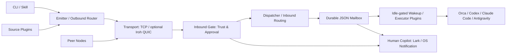

# The Dealer

[](LICENSE)
[](package.json)
[](package.json)
[](native/dealer-iroh-engine/Cargo.toml)
[](https://skills.sh/sensebeing/the-dealer)
[](https://github.com/sensebeing/the-dealer/stargazers)

**将独立运行的 Coding Agent 连成实时、零配置的单机与跨机加密 P2P 协作网络。**

开发者经常在同一台 Mac 上同时运行 Codex、Claude Code、Antigravity 和 Orca，但各个会话彼此隔离。The Dealer 为本机多 Agent 提供统一的投递协议，并将同一套工作流扩展到跨机器、跨团队的加密 P2P 协作。Ed25519 节点身份、接收端信任门禁、持久化 JSON 信箱波次和实时会话唤醒让任务交接可核验，同时通过 `lark-mirror` 与系统 `notify` 执行器让人类协作者同步掌握进展。

| 没有 the-dealer | 接入 the-dealer |
| --- | --- |
| 在隔离的 Codex、Claude Code、Antigravity 和 Orca 终端之间手动复制任务，或通过临时聊天消息交接。 | 统一的同机任务调度，并可扩展到跨机器、跨团队的加密 P2P 投递。 |
| 每次交接都要人工确认接收方是否愿意执行。 | 接收端信任门禁控制任务准入与审批。 |
| 靠聊天记录追踪待处理任务，重启后还要人工核对。 | 持久化 JSON 信箱租约保留未确认批次，支持恢复处理。 |
| 反复查看会话是否空闲、有没有新消息。 | 空闲门禁控制实时会话唤醒，并附带消息内联预览。 |

[English](README.md) · [快速开始](#30-秒上手复制给你的-agent) · [协作场景](#三种渐进式协作场景) · [架构与实时唤醒](#架构分层与实时会话投递) · [宿主预设](#宿主预设agent-应用与一键配置) · [命令速查](#常用命令速查与内置技能)

## 30 秒上手：复制给你的 Agent

将下面任一段提示词发送给 Claude Code、Codex、Cursor、Antigravity 或 Orca。

### 提示词 1：在本机安装或加入协作网

```text
请为本机安装并配置 https://github.com/sensebeing/the-dealer。
先检查现有安装和 Node.js >=22.15。缺少 CLI 时运行
`npm install -g git+https://github.com/sensebeing/the-dealer`；
如果已有可信的 ~/the-dealer 检出，则可运行 `npm --prefix ~/the-dealer link`。
运行 `npx skills add sensebeing/the-dealer --global --agent '*'` 安装技能，
保留已有配置。随后按已安装的 the-dealer-setup 技能引导我选择宿主预设
（orca-dev、codex-dev、claude-dev 或 antigravity-dev）与会话模式（spawn、wave、fixed
或 inbox-only），启动 dealerd 并完成本机自回环验证。
```

### 提示词 2：邀请队友或你的第二台机器

```text
请按 skills/the-dealer-setup/SKILL.md 为我的第二台机器或队友生成 Dealer 网络邀请
（`dealer setup invite-prompt`），并输出一份包含 `dealer-net://v1/...` 邀请链接与
验收步骤、可直接转发给对方的完整接入消息。
```

### 快速安装

无需手动克隆仓库即可安装 CLI：

```sh
npm install -g git+https://github.com/sensebeing/the-dealer
```

已有本地检出时，可运行 `npm --prefix ~/the-dealer link`。为所有支持的 Agent 安装技能：

```sh
npx skills add sensebeing/the-dealer --global --agent '*'
```

Claude Code 也可通过插件市场安装技能：

```text
/plugin marketplace add sensebeing/the-dealer
/plugin install the-dealer@the-dealer
```

## 三种渐进式协作场景

先连接本机已经在用的 Agent，再按需接入第二台工作站或团队成员，全程共用同一套路由与信箱原语。

| 场景 | 接入方式 | 能力说明 |
| --- | --- | --- |
| 同机多 Agent 调度 | `local` 网络（零网络配置） | Orca、Codex、Claude Code 与 Antigravity 通过本机门禁与信箱链路交接任务、互相审查。 |
| 个人多机协作网 | `dealer network mount` 与 `dealer network invite` | 连接 MacBook 与 Studio 或 Linux 工作站，每台机器保留独立 Ed25519 密钥，支持 `member@node` 定向投递。 |
| 团队协作与来源调度 | 共享网络 + `approval_required` 接收门禁 | 按成员或声明的技能路由任务，挂载来源插件，并在重启后自动恢复持久化波次重驱。 |

## 架构分层与实时会话投递



微内核管理插件生命周期与类型化事件。出站路由筛选已认证节点，入站门禁执行准入策略，dispatcher 调用执行器并签发回执，mailbox 则通过文件锁和原子 `fsync` + rename 持久化投递状态。

| 能力 | 行为与边界 |
| --- | --- |
| 消息内联预览 | 唤醒指针直接附带最新消息的单行正文摘要、发送方与线程 ID，短消息无需二次拉取即可读取，同时以信箱租约作为权威状态。 |
| 即时会话唤醒 | 新入队的 `question`、`reply`、`settle` 会话帧首次投递采用 `0ms` 合并窗口，同时遵守活跃租约、忙碌检测与重试退避约束。 |
| Turn Autopilot 兼容 | 空闲检测将 Turn Autopilot 推荐预填识别为空闲，并在向目标根工作区注入唤醒指针前发送 `Ctrl+U`（`\x15`）清空预填文本；人工输入草稿仍保持忙碌保护。 |
| 统一会话模式 | Orca、Codex、Claude Code 与 Antigravity（`agy`）统一支持 `spawn`、`wave`、`fixed` 与 `inbox-only` 四种会话模式，并由持久化唤醒重驱驱动。 |
| 人类协作镜像 | `lark-mirror` 将入站审批与信箱事件同步到飞书卡片或话题，`notify` 执行器发送系统原生通知。 |

详见[架构设计](docs/architecture.md)、[线协议](docs/wire-protocol.md)与[宿主应用矩阵](skills/the-dealer-setup/references/agent-app-matrix.md)。

## 宿主预设、Agent 应用与一键配置

### 宿主 profile 与示例配置

| 宿主（`--host`） | 启动 profile（`--profile`） | 示例 patch | 命名执行器 |
| --- | --- | --- | --- |
| `orca` | `orca-dev` | [orca.patch.json](examples/user-patches/orca.patch.json) | `orca-spawn` / `orca-wave` |
| `codex` | `codex-dev` | [codex.patch.json](examples/user-patches/codex.patch.json) | `codex` |
| `claude-code` | `claude-dev` | [claude-code.patch.json](examples/user-patches/claude-code.patch.json) | `claude-code` |
| `antigravity` | `antigravity-dev` | [antigravity.patch.json](examples/user-patches/antigravity.patch.json) | `antigravity` |

四个启动 profile 默认使用 `open` 门禁并启用 `dedup-cas`；需要审批时使用
`--gate approval_required` 或 `dealer gate mode approval_required`。

### 支持的 Agent 应用与会话模式

| 宿主 / 模式 | `spawn` | `wave` | `fixed` | `inbox-only` | 接收端参数 |
| --- | --- | --- | --- |
| `orca` | 新建子工作区 | 空闲门禁固定工作区 | 接收端项目/工作区路径与内层 `--agent` |
| `codex` | 新建 CLI 工作区会话 | 复用已有线程队列 | 可选 `--agent-profile` 与固定 `--session-id` |
| `claude-code` | 新建后台会话 | 恢复已有会话 | 可选 `--agent-profile` 与固定 `--session-id` |
| `antigravity` | Orca 托管 `agy` 子工作区 | Orca 托管 `agy` 固定工作区 | Orca 工作区或独立 `antigravity` 执行器 |
| `inbox-only`（任意宿主） | 不拉起外部进程 | 不拉起外部进程 | 写入持久化信箱，由人工或会话主动执行 `dealer inbox check` |

同时提供 `chatgpt-dot` 与 `grok-bot`（需指定 `--target-bot`）桥接预设。

### 请求与绑定预设

向 `dealer setup binding-preset` 或 `dealer setup apply-preset` 传入 `--host` 与 `--mode` 组合（默认 topic 为 `collab.request.v4`）：

| 预设组合 | 参数 | 生成的执行器 |
| --- | --- | --- |
| `orca-fixed` | `--host orca --mode fixed` | `orca-wave` |
| `orca-spawn` | `--host orca --mode spawn` | `orca-spawn` |
| `codex-spawn` | `--host codex --mode spawn` | `agent-pty` |
| `codex-fixed` | `--host codex --mode fixed` | `agent-pty` |
| `claude-spawn` | `--host claude-code --mode spawn` | `agent-pty` |
| `claude-fixed` | `--host claude-code --mode fixed` | `agent-pty` |
| `antigravity-spawn` | `--host antigravity --mode spawn` | `orca-spawn` |
| `antigravity-fixed` | `--host antigravity --mode fixed` | `orca-wave` |
| `lark-mirror` | `apply-preset --notify-lark` | 开启该绑定的飞书镜像（在 `~/.dealer/config.json` 中配置 `larkNotify` 凭证与目标） |

```sh
dealer node up --profile codex-dev --json
dealer setup binding-preset --host codex --mode fixed --topic collab.request.v4 --session-id <thread> --json
dealer setup apply-preset --host codex --mode fixed --topic collab.request.v4 --session-id <thread> --set-default --json
dealer setup apply-preset --host orca --mode spawn --project <project-id> --workspace-path <receiver-repo> --agent codex --json
```

`binding-preset` 仅输出建议配置片段；`apply-preset` 会将绑定写入 `~/.dealer/config.json`、启用对应执行器并热更新运行中的守护进程。项目级配置可通过 `dealer project link <repo> --user-patch <file> --json` 挂载。

## 三层渐进式扩展

| 层级 | 配置位置 | 职责边界 |
| --- | --- | --- |
| 1. 个人覆盖 | `~/.dealer/config.json` | 节点 profile、入站审批门禁、执行器参数与通知目标。 |
| 2. 项目补丁 | `~/.dealer/projects/<project>.patch.json` 关联 `.dealer/project.json` | 仓库保存共享 topic 与插件声明，本地目录与会话 ID 保留在接收端机器。 |
| 3. 自定义插件 | Source、Router、Executor 与 Notifier 插件 | 实现 [packages/core-types/index.ts](packages/core-types/index.ts) 中的类型契约，从 `~/.dealer/plugins/` 或 `.dealer/plugins/` 加载。 |

详见 [the-dealer-extend](skills/the-dealer-extend/SKILL.md) 与[插件开发指南](docs/plugin-guide.md)。个人插件可通过 `dealer plugin add`、`dealer plugin list` 与 `dealer plugin remove` 管理。

## 常用命令速查与内置技能

| 命令 | 用途 |
| --- | --- |
| `dealer setup probe --json` | 探测本机已安装的 Agent CLI 与脱敏后的节点配置。 |
| `dealer node up --profile orca-dev --json` / `dealer node status --json` | 启动 `dealerd` 或查看守护进程状态。 |
| `dealer network mount <id> --passphrase '<secret>' --gate approval_required --json` | 使用共享密钥挂载协作网络。 |
| `dealer network invite <id> --ttl 1h --json` | 生成 `dealer-net://v1/...` 网络邀请链接。 |
| `dealer network mount '<invite>' --json` / `dealer network unmount <id> --json` | 加入或卸载指定协作网络。 |
| `dealer peers list --network <id> --json` | 查看指定网络内已发现的节点。 |
| `dealer send --network local --to member:alice --topic collab.request.v4 --body 'Review this change' --json` | 发送路由消息或协作请求。 |
| `dealer inbox check --mailbox <id> --json` | 获取待处理邮件并签发投递租约。 |
| `dealer inbox ack <dlv-id> --mailbox <id> --json` | 确认并结算投递租约。 |
| `dealer thread show <message-id> --json` | 查看会话历史与反向路由状态。 |
| `dealer ask` / `dealer reply` / `dealer settle` | 在双向协作线程中追问、回复或结案。 |

| 内置技能 | 用途 |
| --- | --- |
| [the-dealer-setup](skills/the-dealer-setup/SKILL.md) | 交互式安装、宿主选择、网络挂载与自回环验收。 |
| [the-dealer](skills/the-dealer/SKILL.md) | 日常任务派发、信箱租约消费、线程回复与入站审批。 |
| [the-dealer-extend](skills/the-dealer-extend/SKILL.md) | 个人配置覆盖、项目来源插件与自定义执行器扩展。 |

## 安全边界与开发验证

Ed25519 密钥签署节点名片、信封和投递回执；基于 HKDF-SHA256 派生的网络密钥与 AES-256-GCM 对传输帧做认证加密，流式 BLAKE3 校验内容寻址附件。接收端控制 `open`、`approval_required`、`dnd` 与 `closed` 准入门禁，并将项目 ID 映射到本地可信目录。

运行环境要求 Node.js >=22.15（通过 Node 内置类型剥离直接运行 TypeScript）。构建可选的 Rust Iroh 原生引擎需要安装 Rust/Cargo：

```sh
npm test
guard check --base origin/main
guard review
git diff --check
# 可选：构建 Rust Iroh 原生传输引擎
npm run build:native
```

详见[贡献指南](CONTRIBUTING.md)、[安全政策](SECURITY.md)、[更新日志](CHANGELOG.md)与 [MIT 许可证](LICENSE)。


## 相关开源项目

| 项目 | 用途 |
| --- | --- |
| [the-guard](https://github.com/sensebeing/the-guard) | 架构拓扑检查与合入前独立 Agent 审查。 |
| [the-pilot](https://github.com/sensebeing/the-pilot) | Orca 中基于场景的 Turn Autopilot 与多 Agent 编排。 |

如果 the-dealer 对你们团队的多 Agent 协作有帮助，欢迎在 GitHub 点一颗 Star，让更多团队看到它。
