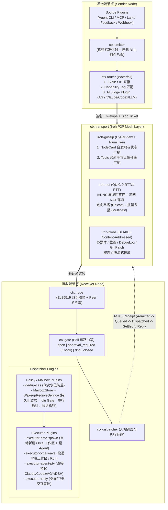

# `the-dealer` — 单机多 Agent 协作与跨机/跨团队实时 Agent 协作网络架构与模块契约设计

> [!IMPORTANT]
> - **项目名称**：`the-dealer`（CLI：`dealer`，后台守护进程：`dealerd`）
> - **核心隐喻与工程模块对齐**：对外品牌采用 *"The Dealer — Deal the right task to the right agent, across any machine"*；内部工程模块严格采用清晰直观的工程命名：**`kernel` / `transport` / `node` / `emitter` / `router` / `gate` / `dispatcher`**。
> - **核心设计准则**：
>   1. **Everything is a Plugin（无特权内核）**：参考 DeepSeek Harness (`Cordis`)，核心能力全部表现为挂载在 `Context` 上的标准 `Service` 与 `Typed Events`，通过 `Profile + Patch` 声明式组装，支持热插拔（HMR）。
>   2. **单一真源（Single Source of Truth）**：节点身份、能力名片（`NodeCard`）、门禁策略、投递租约水位（`Watermark / Revision`）各自由唯一模块拥有，不跨层复制状态。
>   3. **信令与大数据流分离**：控制信封与实时协作消息走低延迟 QUIC Stream / Gossip 树；日志包、截图、音视频、Git Patch 走 `iroh-blobs`（BLAKE3 哈希树内容寻址流），零中心服务器支持千节点级低延迟分发。

---

## 零、 使用层级：Local First，P2P 渐进扩展

`the-dealer` 的第一使用形态是**单机多 Agent / 多工作区自动协作与派发中枢**：一名开发者即可在同一台机器上协调多个专用 Agent 工作区（dev/prod 告警波次、反馈与低质会话认领、prod-release 交接、隔离 Orca 子工作区任务）。当团队挂载加密协作网络后，同一套内核与插件契约再渐进扩展为**跨机器设备互联、跨团队成员 P2P 协作网络**。

### 为什么是 Local First？

绝大多数多 Agent 协作首先发生在同一台开发机上：多个 Orca 工作区、不同 Agent CLI、各类告警/反馈触发源共享同一个开发者与同一份本地代码。若这一层必须依赖网络挂载、口令分发、Peer 发现与远端可达性，单机任务会被无谓地拖入分布式复杂度。`the-dealer` 因此把单机回环作为第一等能力，同时保留与跨机协作完全相同的信封签名、门禁、幂等、波次聚合与执行器链路，避免形成第二套派发栈。

### 第一步 — 单机多 Agent 协作（本地优先，零网络配置）

- 运行 `dealer node up` 启动本机节点；无需 `dealer network mount`、`networkId`、`passphrase` 或任何外部 Peer。
- 将消息发往 `member:<self>`、`skill:<local-skill>` 或本机 `ed25519:<nodeId>`。`transport` 在目标为本机且网络未挂载时，直接在进程内把帧交给同一 `transport/inbound` 处理器；已挂载时则复用本地 endpoint。
- `node.resolveTarget` 优先返回已发现的远端节点，仅在无远端匹配时回退本机自身 `NodeCard`；`router` 将本机名片作为合法候选，`gate` 对本机签名身份放行 `approval_required`（`dnd` 仍入队，`closed` 仍拒收）。
- 项目清单中的 `defaultNetworkId` 只是其触发源在本机发送时使用的稳定作用域名称，不代表必须进行网络挂载。

### 第二步 — 跨机器 / 跨团队成员 P2P 协作（`networkId + passphrase`）

- 团队成员约定 `networkId` 与共享口令 `passphrase` 并执行 `dealer network mount`；`transport` 通过 HKDF-SHA256 派生 `swarmTopicId` 与 AEAD 帧密钥，完成加密发现、准入与网络隔离。
- 签名 `NodeCard`、多维选择器、三级路由、四态门禁、CAS 去重、波次聚合与全部执行器无需改动，即可在加密协作网络内工作。
- 跨机 P2P 是同一内核的渐进扩展，而不是另一套协议或第二真源。

```bash
# 第一步：单机多 Agent 协作（零网络配置）
./bin/dealer.js node up --profile personal-dev --member ben.xu --name mbp --skills agent-runtime --json
./bin/dealer.js send --network local --to member:ben.xu --topic collab.request.v1 --body '{"summary":"Run the local quality sweep"}' --json

# 第二步：跨机器 / 跨团队 P2P 扩展
./bin/dealer.js network mount sensebeing --passphrase "team-shared-secret" --member ben.xu --node mbp-main --json
./bin/dealer.js send --network sensebeing --to member:oliver --topic collab.request.v1 --body '{"summary":"Review the release"}' --json
```

---

## 一、 整体架构拓扑与数据流闭环



---

## 二、 微内核与插件协议设计 (`@the-dealer/kernel`)

完全对齐 DeepSeek Harness (`Cordis`) 的五项核心原语，保证架构极简且具备无限扩展能力：

### 1. 插件协议契约 (`Plugin & Service Contract`)
每个模块或扩展插件都遵循统一的声明周期接口，通过 `inject` 声明依赖，通过 `ctx.effect()` 注册可逆副作用（卸载或配置热更新时自动清理定时器、监听器、子进程与网络连接）：

```typescript
export interface Plugin<C = unknown> {
  name: string;
  /** 显式声明依赖的服务名，内核按依赖拓扑自动等待并激活 */
  inject?: readonly (keyof Services)[];
  /** 插件挂载入口；返回清理函数或内部通过 ctx.effect() 注册可逆副作用 */
  apply(ctx: Context, config: C): void | (() => void | Promise<void>);
}

export interface Services {
  transport: TransportService;   // 底层 P2P 通信与 Blob 传输 (Iroh)
  node: NodeService;             // 本机身份、能力名片与全网 Peer 目录
  emitter: EmitterService;       // 节点内消息发送器与触发源管理
  router: RouterService;         // 发送目标判定器（显式 / 标签 / AI Judge）
  gate: GateService;             // 入站权限控制与敲门审批状态机
  dispatcher: DispatcherService; // 入站调度策略（水位/波次/空闲门禁）与执行器派发
}
```

### 2. 四种类型化事件派发模式 (`Typed Events`)
内核事件总线严格区分四类派发语义，杜绝隐式副作用：

| 事件名称 | 派发模式 | 触发时机与插件职责 |
| :--- | :--- | :--- |
| `node/peer-updated` | `emit`（只读广播） | 发现新节点、节点名片（能力/负载/权限状态）变更或离线时触发 |
| `emitter/prepare` | `waterfall`（洋葱中间件） | 消息发出前依次执行：注入发送方身份 → 打包本地文件为 Blob Ticket → 调用 `router` 解析目标节点列表 |
| `gate/evaluate` | `bail`（短路裁决） | 收到入站消息时优先执行：按规则返回 `allow`、`queue_approval`（待确认）、`defer_dnd`（仅入队）或 `reject`；一旦非 `allow` 立即短路 |
| `dispatcher/route` | `serial`（有序派发） | 通过 `gate` 的消息先经 `PolicyPlugin`（CAS 去重），就绪后交由匹配的 `ExecutorPlugin` 落地执行并回传 `DeliveryReceipt`；非 `rejected` / `failed` 的放行结果统一触发 `dispatcher/inbound`，驱动信箱反向路由与持久化唤醒 |

### 3. `Profile + Bundle + Patch` 声明式配置
与 `dsh` 一致，节点运行时是一棵由 YAML 组装的插件树，保存在 `~/.dealer/profile.yaml`（并支持通过 Agent Skill 写入 `patch.yaml` 实时热更新）：
- **内置 Profile 模板**：
  - `personal-dev`（个人研发节点：开启 mDNS + Team Swarm、Orca Spawn/Wave 执行器、Claude/Codex/AGY 路由判断器、跨人消息默认 `approval_required`）
  - `dedicated-worker`（专属自动化节点，如你的 `prod-release`、`alert-processor`、`ios-crash`：对团队认证成员 `open`，通过持久化 `MailboxStore` + `WakeupRedriveService` 实现波次恢复、权威空闲门禁与会话自动轮转）
  - `headless-relay`（纯命令行或服务器节点：无 GUI 依赖，使用 `agent-pty` 执行器）

---

## 三、 六大核心工程模块详细设计与接口契约

### 模块 1：`transport` — 基于 Iroh 的多网络挂载与 P2P 传输底座 (`@the-dealer/transport`)

职责：**负责「协作网络（`Network`）」的密码学派生与准入握手、同网络节点零配置自发现（mDNS + DHT/Gossip）、以及单播/多播/千节点广播与大文件 Blob 的点对点传输**。

#### 1. 核心设计：什么是 `Network`（协作网络 / 牌桌）？
遵循最简架构与唯一真源原则，**不再单独设立冗余的 `team` 字段——一个协作团队（或个人私域空间）在架构上就是一个 `Network`（牌桌）**，且**一个节点可以同时挂载到多个 `Network`**（如同时挂载个人网络 `ben-home` 与公司团队网络 `sensebeing`）。

团队成员只需约定两个要素即可将各自机器挂载到同一个网络：**`networkId`（网络名称，如 `sensebeing`）+ `passphrase`（团队共享口令/密钥）**。

底层通过 `HKDF-SHA256 / BLAKE3(networkId, passphrase)` 确定性派生出三把核心密钥，实现**无中央服务器的安全自发现与网络隔离**：
1. **`swarmTopicId`（32 字节 Gossip 与发现频道 ID）**：
   - **同局域网（mDNS）**：广播 `swarmTopicId` 的不可逆哈希指纹（外人无法嗅探出明文网络名 `sensebeing`），同一 Wi-Fi/内网下持有相同口令的队友机器在 100ms 内自动识别并直连。
   - **跨公网无中心会合（DHT / Pkarr Rendezvous）**：由口令派生出确定性的虚拟会合槽位（Rendezvous Keypair），挂载到该网络的节点将自己加密后的 `(nodeId, relayUrl, directAddrs)` 宣告至 DHT 会合点并通过 `iroh-gossip` 流行病树扩散——**即使异地办公、无中心服务器、不手工抄写对方公钥，只要对上 `networkId + passphrase`，就能在公网上自动找到同网络的所有队友节点！**
2. **`networkSealedKey`（32 字节 AEAD 对称加密与准入密钥）**：
   - 该网络内的所有 Gossip 广播（含 `NodeCard` 名片交换）与 QUIC 握手证明均使用 `networkSealedKey` 加密认证。**没有正确口令的外部节点不仅在网络上搜不到你们的牌桌，即使知道你的物理 `NodeId` 也无法向该网络注入任何伪造消息。**
3. **支持可选种子节点加速（Bootstrap Hint）**：
   - 虽然通过 `networkId + passphrase` 即可经 mDNS / DHT 自动聚拢，命令仍支持可选传入 `--bootstrap <peer_node_id>`（或导出 `dealer://sensebeing?secret=...&bootstrap=...` 一键邀请码）实现亚秒级冷启动入网。
4. **无 NAT 穿透时的密封中继（Self-hosted headless relay）**：
   - **连通模式**：同网段靠 UDP `239.255.42.99:45873` 组播与子网广播发现；装有 Tailscale 的机器把加密信标单播到 `tailscale status` 中每个在线节点的 UDP 45873 并走 `100.64.0.0/10` 直连；两者都不满足时，由一台常驻 `headless-relay` 节点充当种子。
   - **信标 Gossip**：`announce` 把本机已收集的**密封**发现帧（`beacons`，按 `senderNodeId` 只保留最新有效帧，过期超过 30s 清理）随 `discovery` 探测发给 `bootstrapPeers`，种子回送自己的帧与全部已知信标。节点据此学习对端 endpoint 以及 `relays`（哪个种子可以把帧送到该 peer）。
   - **常驻隧道**：每个挂载网络对每个种子保持一条 `tunnel` 长连接（`keepAlive(15s)`，无空闲超时），种子以 `peerNodeId -> 隧道` 登记。即使对端只宣告了不可直连的 NAT 地址，种子也能沿隧道把 `relay_deliver` 推回去，对端的 `relay_reply` 再沿原路返回。
   - **盲转发**：`exchange` 先直连；存在中继候选时直连只等 1500ms，失败后改发 `relay` 请求。种子只校验该信封确实属于已挂载网络的 AEAD 密钥（不解析业务载荷），按目标隧道或直连转发。附件拉取同理：直连失败后发 `relay_blob`，由种子向目标按 BLAKE3 内容取回并回传，单次中继载荷上限 `MAX_FRAME - 4096`。
   - **地址宣告**：`--advertised-host <host>`（或 `DEALER_ADVERTISED_HOST`）覆盖自动探测的 LAN 地址，供反向代理、端口映射或多网卡主机使用。

```typescript
export interface NetworkMountConfig {
  networkId: string;             // 网络可读标识，如 "sensebeing" 或 "ben-home"
  passphrase: string;            // 团队约定的共享口令（本地派生密钥，绝不明文上链/外发）
  bootstrapPeers?: readonly string[]; // 可选种子节点 NodeId，加速跨公网冷启动会合
  admissionMode?: AdmissionMode; // 该网络专属的默认入站门禁（如个人网 "open"，团队网 "approval_required"）
  exposedSkills?: readonly string[];  // 可选：仅向该网络暴露本机的部分特定技能（不填则暴露全部）
}

export interface DerivedNetworkKeys {
  networkId: string;
  swarmTopicId: string;          // BLAKE3/HKDF 派生的 32B Gossip & mDNS 发现 Topic ID (hex)
  rendezvousPublicKey: string;   // 跨网 DHT 会合槽位公钥
  sealedKey: Uint8Array;         // 32B AEAD 帧加密与握手准入密钥
}

export interface BlobAttachment {
  name: string;                  // 文件名，如 "crash-report.jsonl.gz" 或 "api-contract.patch"
  mimeType: string;              // MIME 类型，支持 application/octet-stream, image/png, audio/* 等
  sizeBytes: number;
  blake3Hash: string;            // Iroh BLAKE3 内容寻址哈希
  ticket: string;                // Iroh BlobTicket，接收端凭此直接通过 QUIC P2P 分块拉取
}

export interface TransportService {
  readonly localNodeId: string;  // 本机 Ed25519 公钥编码 (NodeId)

  /** 挂载/卸载协作网络（支持单节点同时挂载多个 Network） */
  mountNetwork(config: NetworkMountConfig): Promise<MountedNetworkHandle>;
  unmountNetwork(networkId: string): Promise<void>;
  listMountedNetworks(): readonly string[];

  /** 1. 定向单播 (Unicast)：在指定 Network 域内通过 QUIC 双向流直接发送并等待回执 */
  sendUnicast(networkId: string, targetNodeId: string, frame: Uint8Array, opts?: { timeoutMs?: number }): Promise<Uint8Array>;

  /** 2. 批量多播 (Multicast)：并发复用到多个目标节点的 QUIC 连接池 */
  sendMulticast(networkId: string, targetNodeIds: readonly string[], frame: Uint8Array): Promise<Map<string, Result<Uint8Array>>>;

  /** 3. 网络内广播 (Broadcast)：基于 iroh-gossip (HyParView + PlumTree) O(log N) 流行病广播树 */
  broadcast(networkId: string, subTopic: string, frame: Uint8Array): Promise<void>;

  /** 4. 多媒体与大文件流 (iroh-blobs)：本地文件零拷贝挂载为内容寻址 Blob，接收端按需拉取 */
  shareFile(filePath: string): Promise<BlobAttachment>;
  fetchBlobToPath(ticket: string, destPath: string): Promise<void>;
}
```

---

### 模块 2：`node` — 节点身份、多网络挂载名片与全网目录 (`@the-dealer/node`)

职责：**管理本机节点身份（`Identity`）与能力描述（`NodeCard`），并按已挂载的 `Network` 维护各网络内活跃队友节点的实时目录（`PeerDirectory`）**。

```typescript
export interface SkillCapability {
  id: string;                    // 如 "ios-crash-triage", "prod-release", "agent-runtime-review"
  description: string;           // 供 AI Router Judge 阅读的自然语言能力边界描述
  tags?: readonly string[];      // 供确定性路由匹配的标签，如 ["ios", "swift", "dsym"]
  acceptedTypes?: readonly string[]; // 接收的消息类型，如 ["alert.crash", "collab.request"]
}

export interface NodeCard {
  nodeId: string;                // Ed25519 公钥 (唯一加密身份)
  networkId: string;             // 当前名片所属的协作网络 ID（如 "sensebeing"）
  revision: number;              // 单调递增名片版本号（防旧状态回退）
  identity: {
    member: string;              // 成员标识，如 "ben.xu", "oliver", "diz"
    nodeName: string;            // 机器/节点名，如 "mbp-harlequin", "seabass-release"
  };
  admissionMode: AdmissionMode;  // 该节点在当前 Network 下的权限状态："open" | "approval_required" | "dnd" | "closed"
  capabilities: {
    summary: string;             // 节点整体职责简介
    skills: readonly SkillCapability[];
  };
  runtimeState: {
    load: "idle" | "busy" | "overloaded";
    activeTasks: number;
    availableAgents: readonly string[]; // ["antigravity", "claude", "codex"]
  };
  updatedAt: string;             // ISO-8601
  signature: string;             // NodeId 私钥对上述字段的签名，防网络内成员伪造他人身份
}

export interface NodeService {
  getSelfCard(networkId: string): NodeCard;
  updateSelfProfile(patch: Partial<{ member: string; nodeName: string; capabilities: NodeCard["capabilities"] }>): Promise<void>;
  /** 按 Network 列出已发现的活跃节点名片 */
  listPeers(filter?: { networkId?: string; member?: string; skillTag?: string; onlyAvailable?: boolean }): readonly NodeCard[];
  /** 支持跨网或指定网解析选择器，如 "sensebeing/member:oliver", "ben.xu@mbp", "skill:prod-release" */
  resolveTarget(selector: string, defaultNetworkId?: string): readonly NodeCard[];
}
```

---

### 模块 3：`emitter` — 节点内消息发送器与触发源扩展 (`@the-dealer/emitter`)

职责：**提供极高自由度的消息构造与发送入口，向下统一转换为带 `networkId` 作用域的标准 `MessageEnvelope`，支持外部事件源插件（`SourcePlugin`）与本地 Agent 直接调用**。

```typescript
export interface MessageEnvelope<T = Record<string, unknown>> {
  id: string;                    // 全局唯一消息 ID (ULID/UUIDv7)
  networkId: string;             // 所属协作网络 ID（如 "sensebeing"）
  traceId: string;               // 跨节点协作会话线程 ID（支持 ask / reply 多轮交互）
  replyToId?: string;            // 回复的具体消息 ID
  idempotencyKey?: string;       // 业务幂等键，如 "feedback:dev:7778ef78:v2" 或 "alert:ae_123"
  from: {
    nodeId: string;
    member: string;
    nodeName: string;
  };
  routing: {
    mode: "unicast" | "multicast" | "broadcast" | "auto";
    targets?: readonly string[]; // 显式目标（NodeId / "member:xxx" / "skill:xxx"）；mode="auto" 时可留空交由 Router 判定
    topic?: string;              // mode="broadcast" 时的网络内子频道
    hint?: string;               // 给 Router Judge 的自然语言路由提示，如 "发给负责运行时且当前空闲的队友"
  };
  kind: string;                  // 动态消息类型，如 "task.dispatch" | "collab.request" | "alert.event" | "agent.ask" | "agent.reply"
  priority: "urgent" | "high" | "normal" | "low";
  subject: string;               // 一句话标题
  body: string;                  // Markdown 正文或 Prompt 指令
  payload: T;                    // 任意结构化扩展载荷（由各业务插件自定义 Schema）
  attachments: readonly BlobAttachment[]; // 多媒体/文件/日志包/Git Patch 列表
  createdAt: string;
  signature: string;             // 发送端 Ed25519 签名
}

export interface EmitterService {
  /** 核心发送接口：支持本地文件路径自动转 BlobTicket、自动在指定 networkId 内触发 Router 解析目标并发送 */
  emit<T>(input: EmitMessageInput<T>): Promise<EmitResult>;

  /** 注册外部事件触发源插件（如 Lark 告警轮询、Feedback 认领唤醒、Webhook、Cron） */
  registerSource(source: SourcePlugin): Disposable;
}
```
- **内置与可扩展的 `SourcePlugin`（把 `alter-service` 触发源彻底插件化）**：
  - `plugin-source-cli-mcp`：供节点内正在运行的 Agent（AGY / Claude Code / Codex）通过 CLI 或 MCP 直接发消息。
  - `plugin-source-webhook`：本地安全 HTTP 端点（如承接 Source Hub `/feedback/wake` 或 GitLab/GitHub 事件）。
  - `plugin-source-poll-watermark`：通用水位轮询触发器基类，直接承载你的飞书多维表格告警源、Source Hub 反馈认领源、Runtime Monitor 低质会话源。

---

### 模块 4：`router` — 发送判断器与智能路由模块 (`@the-dealer/router`)

职责：**在 `emitter` 发送消息时运行，将未绑定具体物理 `nodeId` 的消息，精准解析为 1 个或多个目标节点的 `NodeId`**。

支持**三级可插拔路由判定链（Matcher Pipeline）**：

```typescript
export interface RouteDecision {
  mode: "unicast" | "multicast" | "broadcast";
  targetNodeIds: readonly string[];
  matchedBy: string;             // 命中的路由器插件名，如 "explicit-id" | "capability-tag" | "judge:claude-code"
  reason: string;                // 可审计的路由理由
}

export interface RouteJudgePlugin {
  name: string;
  priority: number;
  /** 给定待发消息与当前全网活跃节点的 NodeCard 列表，返回路由裁决；返回 null 则交由下一级插件 */
  decide(envelope: MessageEnvelope, candidates: readonly NodeCard[]): Promise<RouteDecision | null>;
}
```
1. **Level 1 — `ExplicitSelectorJudge`（确定性显式寻址，内置）**：
   - 当 Agent 已经通过 Skill 查看了节点列表并指定了 `targets: ["oliver@mbp"]` 或 `targets: ["member:diz"]`，毫秒级直接解析为对应 `NodeId`。
2. **Level 2 — `CapabilityRuleJudge`（标签与技能规则匹配，内置）**：
   - 当消息指定了 `targets: ["skill:prod-release"]` 或 `payload.area == "agent-runtime"`，自动筛选具备该 Skill 且 `admissionMode != "closed"`、负载最优的节点。
3. **Level 3 — `AgentLLMJudgePlugin`（AI 智能发送判断器插件，核心亮点！）**：
   - 当发送的是一条**非指向性消息**（`routing.mode = "auto"`），插件自动组装全网候选节点的 `NodeCard`（成员、能力描述 `summary/skills`、当前空闲状态 `load`），调用可配置的判断后端：
     - **`judge-backend-llm-api`**：调用轻量模型 API（如 DeepSeek / Claude Haiku / Gemini Flash）做 JSON 结构化路由选择；
     - **`judge-backend-local-agent`**：直接调用本机注册的 `agy` / `claude -p` / `codex exec` 无头判定器，决定该发给哪个或哪几个节点（支持自动拆分为单播或多播）。

---

### 模块 5：`gate` — 节点权限状态机与入站门禁 (`@the-dealer/gate`)

职责：**守护接收端节点的大门，让节点拥有对入站消息的绝对控制权**。

```typescript
export type AdmissionMode =
  | "open"               // 开放接收：验证签名与允许域后直接放行进入 dispatcher
  | "approval_required"  // 待确认后接收（Knock 敲门模式）：挂起进入本地待审批队列，通知节点主人或主 Agent 确认
  | "dnd"                // 免打扰（僅入队）：接收并持久化到待办队列，暂停自动拉起新终端，待解除 dnd 后派发
  | "closed";            // 完全拒收：直接返回 rejected 回执

export type GateVerdict =
  | { status: "allow" }
  | { status: "pending_approval"; approvalId: string; reason: string }
  | { status: "queued_dnd"; reason: string }
  | { status: "reject"; code: string; reason: string };

export interface GateService {
  getMode(): AdmissionMode;
  setMode(mode: AdmissionMode): Promise<void>;
  /** 细粒度 ACL 策略插件：例如「本机自己的其它节点或 dev 告警流免审 open，跨成员发来的新 task 需要 approval_required」 */
  registerRule(rule: GateRulePlugin): Disposable;
  /** 审批操作：确认放行单条消息（并可选将该发送方/技能加入信任白名单）或拒绝 */
  approve(approvalId: string, opts?: { trustSender?: boolean }): Promise<void>;
  reject(approvalId: string, reason?: string): Promise<void>;
  listPendingApprovals(): readonly PendingApprovalItem[];
}
```
- **极佳的人机体验**：当队友（比如 Oliver）的 Agent 给你的节点发来一条跨模块协作请求，而你处于 `approval_required` 状态时：
  - 发送方立即收到 `{ status: "admitted_pending_approval" }` 回执（知道消息已安全送达你的机器，正在等你点头）；
  - 你的机器弹出一条通知（或在你当前活跃终端显示提示），你只需运行 `dealer gate approve <id>`（或者对当前 Agent 说一句“同意 Oliver 刚发来的请求”），消息立刻进入 `dispatcher` 自动为你拉起 Orca 隔离工作区并启动 Agent 处理！

---

### 模块 6：`dispatcher` — 节点内消息派发器与执行器插件系统 (`@the-dealer/dispatcher`)

职责：**决定通过门禁后的消息在本地如何被排队、合并、限流，并最终交给哪个本地工具/工作区执行**。

我们将你在 `alter-service` 中沉淀的精华设计拆解为 **「调度策略插件 (`PolicyPlugin`)」+「终端执行器插件 (`ExecutorPlugin`)」** 两层正交组合：

```typescript
export type DeliveryStage =
  | "received"           // 网络层已验签接收
  | "pending_approval"   // Gate 挂起等待节点主人确认
  | "queued"             // 已入队（等待 Wave 聚合或等待目标工作区空闲 Idle Gate）
  | "dispatching"        // 正在创建本地资源（如 Orca worktree / terminal）
  | "dispatched"         // 已成功投递给本地 Agent 并获得终端回执
  | "settled"            // 本地 Agent 已完成处理并结案（附带结果摘要或 Reply）
  | "failed";            // 派发异常（保留现场与恢复游标）

export interface DispatchPolicyPlugin {
  name: string;
  /** 对入站消息进行去重、水位检查、波次合并或等待工作区空闲 */
  process(envelope: MessageEnvelope, next: (batch: readonly MessageEnvelope[]) => Promise<DispatchReceipt>): Promise<DispatchReceipt>;
}

export interface ExecutorPlugin<C = unknown> {
  name: string;                  // 如 "orca-spawn", "orca-wave", "agent-pty", "webhook-forward"
  /** 检查目标执行环境是否空闲可用（供 Wave Coalescer 的 Idle Gate 调用） */
  checkIdle?(config: C): Promise<{ idle: boolean; reason?: string }>;
  /** 真正执行派发（如创建 Orca 工作区、启动终端、发送 Prompt），返回可持久化的外部资源回执 */
  execute(batch: readonly MessageEnvelope[], context: ExecutionContext, config: C): Promise<ExecutionReceipt>;
}
```

#### 官方核心内置插件清单（100% 覆盖并升维 `alter-service` 全部场景）

1. **调度策略插件 (`packages/plugins-policy/`)**：
   - **`plugin-policy-dedup-cas`**：基于 `idempotencyKey` 与单调代次水位（`claim_version / revision`）的本地持久化状态账本，确保同一事件精确派发一次，故障重启后沿用原回执对账，绝不重复建工作区。
2. **持久化信箱与唤醒重驱 (`packages/mailbox/`)**：
   - **`MailboxStore`**：唯一原子落盘的信箱账本，承载逻辑 `mailboxId`、单未决租约 `dlv_*`、`wakeTargets` 重驱状态、`inbound:` / `outbound:` 方向化线程路由与旧 `inbox.json` 一次性迁移；通过文件锁 + `fsync`/`rename` 落盘，并以事件唤醒而非轮询驱动消费者。
   - **`WakeupRedriveService`**：取代易失的 wave-coalescer。目标工作区忙碌或不可判定时只保留持久化 `pendingWake`，绝不注入文本；仅在权威 Orca 工作区/终端空闲门禁通过后投递严格单行指针，空闲探测或投递前准备失败按 1s → 2s → 5s → 10s 退避，安全待投递工作在守护进程重启后恢复，租约确认后才按 `completedWaves` 阈值执行 `/new` 轮转。首次在工作区解析出的 Orca 终端句柄随 `wakeTargets` 持久化，后续波次优先复用同一终端（含已标记 orphaned 但仍 connected 的 TUI），避免固定工作区在多终端之间漂移。
3. **执行器插件 (`packages/plugins-executor/`)**：
   - **投递结算与未知结果**：`MailboxStore.beginWakeDelivery` 在外部命令或终端注入前持久化 `deliveryInDoubt`，只有成功回执才由 `completeWakeDelivery` 清除此围栏。进程已启动后的错误、abort 或进程中断保留围栏与原因；命令边界确认进程从未启动的前置失败（`CommandNotStartedError`）以及投递前的准备失败（工作区/终端解析、权威空闲门禁、参数校验）不产生围栏，按 1s → 2s → 5s → 10s 指数退避重试。后续入队、强制 flush 与重启均不能自动重放未知结果，须先核实外部结果再显式修复目标；成功结算只覆盖预览序号水位内的消息，新入队消息保留 `enqueue` 决定的截止时间；会话帧即时唤醒，普通波次仍遵守 coalescing。初始执行器（`agent-pty` / 命名宿主 / `orca-spawn`）与后台重驱共用同一套 `deliverPassiveWakeTarget` / `deliverSpawnedOrcaTerminalWakeup` 投递原语，不各自复制指针构造与终端注入。
   - **宿主会话身份**：`agent-host` 唯一负责身份映射和启动回执解析。显式 `sessionId` 原样保留；Claude 缺省名称由信箱 ID 可逆编码，Dot/Grok 使用原始信箱 ID。Codex spawn 仅在启动 JSON 的 `threadId`/`sessionId` 可用时启用 fixed 续接，不能用未传给创建过程的显式 ID 冒充新会话身份；无身份的 Codex 与独立 `agy run` 成功后清除自动宿主唤醒绑定，信箱仍可手动读取。已有 fixed 会话不从任务输出重新推断身份。
   - **`plugin-executor-orca-spawn`（独立工作区派生器）**：
     - 对应你的 `feedback_dispatcher`、低质会话派发与跨人协作 Request。
     - 收到消息后：自动下载附件 Blob 到私有目录 → 调用 `orca worktree create` 创建独立工作区 → 预授权 `trustedWorkspaces` → 调用 `orca terminal create` 启动 `agy / claude / codex` → 持久化任务信箱并等待 `tui-idle` 确认后才注入单行任务前言。
   - **`plugin-executor-orca-wave`（常驻工作区 / Run 投递器）**：
     - 对应你的 6 条告警流、`ios-crash` 与 `prod-release`（`run_9ae56f59708c`）。
     - 收到单条或聚合波次消息后：先持久化入队到 `stream:<streamKey>` 并登记唤醒目标；工作区忙碌时仍返回 `dispatched`，由 `WakeupRedriveService` 在空闲门禁通过后向绑定终端（或 `orca orchestration send --to run:<id>`）投递单行指针并更新卡片状态备注。
   - **`plugin-executor-agent-pty`（零 Orca 依赖的通用 CLI Agent 执行器）**：
     - 让全球任何没有安装 Orca 的开源用户也能开箱即用：通过本地 `git worktree` + 后台 PTY / `tmux` / headless 模式直接拉起 `claude`、`codex`、`deepseek-harness (dsh)` 或自定义 Shell 脚本处理任务，并将执行结果自动 `reply` 回发送节点。

---

## 四、 配套 Agent Skill 与 CLI 控制面设计 (`dealer-skill`)

项目内置一套标准 `SKILL.md`（可一键安装到 `~/.gemini/skills/the-dealer`、`~/.claude/skills/the-dealer`、`~/.agents/skills/the-dealer`），让任何 Agent 都能通过极为简洁的 `dealer` CLI（全部支持 `--json` 结构化输出）操控全流程：

| 场景分类 | Agent 调用的 CLI 命令示例 | 作用说明 |
| :--- | :--- | :--- |
| **1. 挂载与管理节点** | `dealer node up --name mbp-harlequin --member ben.xu --team sensebeing --json`<br>`dealer node card set --summary "..." --add-skill prod-release:"..." --json` | 启动本机 P2P 守护进程，设置节点身份与能力名片并实时广播到全网 |
| **2. 切换节点权限门禁** | `dealer gate mode approval_required --json`<br>`dealer gate list --json`<br>`dealer gate approve <approval_id> --trust-member oliver --json` | 自由切换 `open / approval_required / dnd / closed`，查看并批准待确认的跨节点消息 |
| **3. 发现全网节点与能力** | `dealer peers list --skill ios-crash-triage --only-available --json` | Agent 发送前可自主查询当前在线的队友节点及其能力描述与空闲状态 |
| **4. 发送消息（定向/多播/广播/AI路由）** | **显式定向**：`dealer send --to member:oliver --kind collab.request --subject "..." --body "..." --attach ./repro.log --json`<br>**AI 智能判断路由**：`dealer send --auto-route --hint "找负责运行时且空闲的节点排查此报错" --body "..." --json`<br>**全网/频道广播**：`dealer broadcast --topic team.sensebeing --subject "..." --body "..." --json` | 一条命令完成跨机器、跨团队成员的实时消息与大附件投递，支持 `--wait-receipt` 或异步流式回调 |
| **5. 配置节点内收发派发器** | `dealer route add --match-kind "collab.request" --policy dedup-cas --executor orca-spawn --agent codex --json`<br>`dealer source add lark-alert --config ./alerts.yaml --json` | Agent 通过命令直接生成 `patch.yaml`，热挂载新的触发源或本地 Orca/Agent 派发规则 |

---

## 五、 技术栈与仓库目录结构设计

为了同时达到 **「像 DeepSeek Harness 一样极致的插件可编程性」** 与 **「Rust Iroh 级别的千节点 P2P 高性能」**，建议采用 **TypeScript (Node >= 22, pnpm workspace) + Rust (`iroh` Core Sidecar/Addon)** 混合架构（同时提供 `plugin-executor-script` 与 `plugin-source-script` 让现有的 Python 脚本也能零改造接入）：

```text
the-dealer/                                 # 独立开源仓库根目录（建在 alter-service 相邻目录）
├── Cargo.toml                              # Rust Workspace（编译高性能 Iroh P2P 网络引擎）
├── pnpm-workspace.yaml                     # TypeScript 插件与内核 Workspace
├── package.json
├── README.md                               # 英文主文档（The Dealer 品牌与架构图）
├── README.zh-CN.md                         # 中文完整文档
├── docs/
│   ├── architecture.md                     # 微内核 (Cordis-style) 与六大模块架构设计
│   ├── wire-protocol.md                    # Envelope 签名、QUIC 流、Gossip 与 BlobTicket 规范
│   └── plugin-guide.md                     # 如何用 30 行代码编写 Source / Router / Gate / Executor 插件
├── native/
│   └── dealer-iroh-engine/                 # Rust 实现的 Iroh P2P 核心层 (iroh-net + iroh-gossip + iroh-blobs)
│       ├── Cargo.toml
│       └── src/
│           ├── lib.rs                      # 暴露给 TS 内核的高性能 IPC / NAPI 接口
│           ├── endpoint.rs                 # Ed25519 NodeId、mDNS 局域网发现、QUIC NAT 穿透连接池
│           ├── gossip.rs                   # HyParView + PlumTree 节点名片同步与千节点频道广播
│           └── blobs.rs                    # BLAKE3 多媒体与大文件分块流式传输
├── packages/
│   ├── kernel/                             # @the-dealer/kernel：Context、Service 注入、Typed Events、Reversible Effects、Profile/Patch Loader
│   ├── core-types/                         # @the-dealer/core-types：NodeCard、MessageEnvelope、DeliveryReceipt 唯一 Schema 真源
│   ├── transport/                          # @the-dealer/transport：TransportService 接口与 Iroh Engine 桥接插件
│   ├── node/                               # @the-dealer/node：节点身份密钥管理、NodeCard 签名广播、PeerDirectory
│   ├── emitter/                            # @the-dealer/emitter：消息组装、附件自动转 Blob、SourcePlugin 宿主
│   ├── router/                             # @the-dealer/router：三级路由链（Explicit -> Tag Rule -> AI/Agent Judge）
│   ├── gate/                               # @the-dealer/gate：open / approval_required / dnd / closed 状态机与 ACL 规则
│   ├── dispatcher/                         # @the-dealer/dispatcher：入站账本、Policy 链与 Executor 宿主
│   ├── mailbox/                            # @the-dealer/mailbox：持久化信箱账本、租约、方向化线程路由与 WakeupRedriveService
│   ├── orca-workspace/                     # Orca 工作区/终端空闲检查、终端解析与单行投递的唯一 owner
│   ├── plugins-source/                     # 官方内置发送触发源插件包
│   │   ├── source-webhook/                 # 本地 HTTP Webhook 接收器
│   │   ├── source-poll-watermark/          # 通用单水位轮询触发器（可配置对接 Lark / SourceHub / Monitor）
│   │   └── source-script/                  # 挂载任意外部 Python/Shell 脚本作为消息源
│   ├── plugins-router/                     # 官方内置智能路由判断器插件包
│   │   ├── router-llm-api/                 # 调用 OpenAI/Anthropic/DeepSeek兼容 API 根据 NodeCard 判定目标节点
│   │   └── router-local-agent/             # 调用本机 Claude Code / Codex / AGY headless 判定目标节点
│   ├── plugins-policy/                     # 官方内置入站调度策略插件包
│   │   └── policy-dedup-cas/               # 幂等水位与版本 CAS 防重插件
│   ├── plugins-executor/                   # 官方内置终端派发执行器插件包
│   │   ├── executor-orca-spawn/            # 自动新建 Orca Worktree 并拉起 Agent 会话处理
│   │   ├── executor-orca-wave/             # 向常驻 Orca 工作区终端或受控 Run 投递波次并更新卡片状态
│   │   ├── executor-agent-pty/             # 通用无 Orca 环境：通过 git worktree + PTY/Subprocess 启动 Claude/Codex/AGY/DSH
│   │   └── executor-notify/                # macOS 原生通知 / 飞书通知与人工确认交互
│   └── cli/                                # @the-dealer/cli：`dealer` 与 `dealerd` 命令行入口及内置 Profiles
└── skills/
    └── the-dealer/                         # 配套 Agent Skill（一键安装至 ~/.gemini/skills 或 ~/.claude/skills）
        ├── SKILL.md                        # 供 Agent 阅读的挂载节点、查节点表、发消息、配派发器完整指令
        └── references/
            ├── profile-And-patch-spec.md
            └── writing-custom-plugins.md
```

---

## 六、 分阶段实施路线图（Roadmap）

一旦你确认上述模块契约与目录结构，我们将在相邻目录创建新仓库（如 `/Users/ben.xu/orca/workspaces/the-dealer` 或你指定的平级路径），分 4 个高内聚阶段推进实现：

1. **Phase 1 — 微内核与核心契约底座 (`kernel` + `core-types` + `node` + `gate` + `dispatcher` 状态机)**：
   - 实现类 Cordis 的 `Context / Service / Typed Events (emit, waterfall, bail, serial) / Reversible Effect / Profile & Patch Loader`；
   - 实现 `NodeCard`、`MessageEnvelope`、签名验签、`GateService` 四态门禁状态机与基于 SQLite WAL 的 `DispatcherService` 投递账本。
2. **Phase 2 — Iroh P2P 高性能网络底座 (`native/dealer-iroh-engine` + `transport`)**：
   - 基于 Rust `iroh` 实现 `NodeId` 拨号、mDNS 局域网零配置自发现、跨网 QUIC 直连、`iroh-gossip` 千节点频道广播与 `NodeCard` 实时同步、`iroh-blobs` 多媒体/大文件流式传输。
3. **Phase 3 — 发送路由与接收执行全插件生态 (`emitter` + `router` + `plugins-*`)**：
   - 实现三级智能路由链（显式 ID + Capability Tag + 本地 Agent/LLM Judge 插件）；
   - 实现 `policy-dedup-cas`、持久化 `MailboxStore` 与 `WakeupRedriveService`（波次恢复 + Idle Gate + 单行指针 + 会话轮转）；
   - 实现 `executor-orca-spawn`、`executor-orca-wave` 与通用的 `executor-agent-pty`。
4. **Phase 4 — CLI、`dealer` 配套 Skill 与 `alter-service` 真实场景迁移验证**：
   - 交付 `dealer` / `dealerd` CLI 与 `skills/the-dealer/SKILL.md`；
   - 在本机实跑双节点/多节点 P2P 自动发现、权限审批（`open` vs `approval_required`）、智能路由判断、大文件传输及自动唤醒 Orca 工作区端到端验收。


### Lark Human Copilot Mirror

`packages/plugins-lark-notifier` exports the first-class Kernel plugin
`lark-mirror` (`createLarkMirrorPlugin`). Gate remains the sole admission owner:
it emits `gate/pending-approval` only when adding a new pending item. The mirror
seeds existing approvals on activation and renders actionable human approval
knocks, observes mailbox arrivals, and mirrors local `emitter/sent` messages into
existing Lark threads. It never approves or dispatches work itself. Kernel effects
own notifier startup/shutdown, including cancellation of retries and commands.

One serialized notifier owns Lark delivery, bounded exponential retries, and
atomic `the-dealer-lark-notify/v1` state. Mailbox catch-up precedes outbound
mirroring, so a watched local loopback is not sent twice. Thread roots and
idempotency keys are shared across approval, mailbox, and outbound delivery;
deleted roots use a distinct fallback key. Pending event queues are in-memory,
not a durable outbound replay log. The local `notify` executor only owns OS
notification or file sinks, with no Lark webhook transport.

`notifyGateApprovals` and `mirrorOutboundThreads` default to true. Default watched
mailboxes omit compound topic/stream bindings and project topics with background
`orca-wave`, `orca-spawn`, or `agent-pty` defaults; explicit `notifyLark` overrides
that choice. Inbox topics and top-level request bindings remain included. See
[request threading](request-threading.md) for filters and configuration.

### Automatic upgrades and restart

`dealer self-update` synchronizes a clean main checkout and skill links. `dealer node down` drains active work before shutdown and `dealer node restart` combines that drain with startup. A daemon `runtimeFingerprint` covers host and linked project code; external changes trigger a background restart only after active dispatches and control requests become idle.
